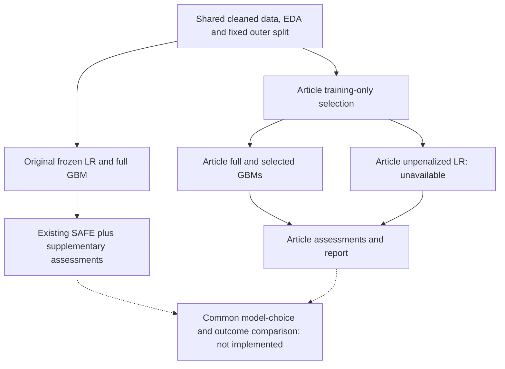

# Credit-risk project wiki

Updated **12 October 2026**. Start here in new chats; open detailed evidence only for the task at hand. This is the current state, not a conversation log. Latest user instructions override older plans. Earlier discussion is preserved in [history](docs/context/project_context_history_2026-10-12.md).

## 1. Purpose and current direction

We began by comparing a relatively transparent logistic regression (LR) with a more predictive gradient boosting model (GBM) across performance, fairness, explainability and robustness. The professor's reported feedback was to establish a clear, material reason for our methodology to exist beyond SAFE, while making the indicators easier to follow.

**Andrei's latest direction, recorded on 10 October:**

1. Fix and align the shared models; probably include more than two model families.
2. Find additional performance evaluators in the literature.
3. Combine indicators into a score, provisionally an average.
4. Compare which models the two methodologies select from the same pool.
5. Test whether the extra indicators improve model choice. Supported findings could become one or more articles.

The extra models, indicators, score and criterion for a better choice are **undecided and unimplemented**. Superiority is a hypothesis. The assistant's proposed pivot to a simpler model-comparison study was **not adopted**. Additional indicators are a planned research direction; this does not revive every item in the older expanded-framework proposal.

## 2. What exists

| Component | Current state |
| --- | --- |
| Original project | Data/EDA, frozen LR/GBM, performance, fairness, explainability and robustness complete |
| Separate 2024 article implementation | All four work packages completed and reproduced on 10 October; GBM works; article LR results unavailable |
| Shared model revision / category pooling | Discussed, not executed |
| New composite score / framework-selection experiment | Not implemented |
| PSI, monitoring, mitigation, formal intersectionality, deployment governance | Not implemented; no execution requested |

“Our methodology” currently means the original project's native SAFE metrics plus conventional metrics, SHAP, semantic stress tests and uncertainty. A new overall selection rule has not been built. Romanian credit data have been requested but are not available here.

## 3. Architecture

[Current architecture PNG](output/diagrams/project_architecture_current.png). The article full GBM was fitted separately but produces **exactly the same holdout probabilities** as the original full GBM. Its selected three-input GBM is a different candidate.

**Target:** shared preparation and candidate models -> both assessment methodologies -> compare their choices against an independent outcome criterion. Article feature selection also produces models; distinguish evaluating that procedure from assessing identical fixed candidates. Fewer inputs and a more transparent decision rule are different kinds of simplicity.

Original code: `src/baseline.py`, `src/*_evaluation.py`, `src/safe_adapter.py`. Separate article code: `article_safe/`; [package guide](article_safe/README.md).

## 4. Results we can defend

Same 5,996-record holdout. Recall/FPR use strict probability >0.50. AP = sklearn average precision; lower Brier is better.

| Candidate | Inputs | AUC | AP | Brier | Default recall | FPR |
| --- | ---: | ---: | ---: | ---: | ---: | ---: |
| Existing regularized LR | 22 | .7569 | .5270 | .1382 | .3545 | .0511 |
| Full GBM, same result in both branches | 22 | .7781 | .5521 | .1350 | .3515 | .0507 |
| Article-selected GBM | 3 | .7512 | .5079 | .1402 | .3447 | .0475 |

- GBM ranks better and has lower probability losses; both full models detect about 35% of defaults at .50. No overall model recommendation follows.
- Article GBM selection kept **PAY_0, LIMIT_BAL, PAY_AMT1**. Adding PAY_2 slightly reduced validation AUC, triggering the first stop; later improvement did not undo it.
- Selected-minus-full GBM AUC = **-.02695**, conditional paired 95% interval **[-.03485, -.01895]**. Andrei considers this potentially marginal given 19 fewer inputs. Statistical significance alone does not establish material weakness or framework superiority.
- Fairness has no overall winner. Female-minus-male recall gaps: LR .0232 / GBM .0335. Original primary gap intervals include zero; that does not prove fairness.
- PAY_0 and LIMIT_BAL dominate SHAP. Top-three shares: LR 54.2% / full GBM 40.9%; concentration is not a fairness or human-interpretability verdict.
- Semantic joint corruption q=.10 gave decision flips LR .79% / GBM 1.30%; native SAFE joint tail swapping p=.05 gave 11.44% / 11.12%. Exposure/severity differ, so the scenarios are not equivalent. These are synthetic sensitivity results.

Evidence: [performance](outputs/performance_evaluation_report.md), [fairness](outputs/fairness_evaluation_report.md), [explainability](outputs/explainability_evaluation_report.md), [robustness](outputs/robustness_evaluation_report.md), [article results](article_safe/runs/article_v1_2026-10-10/report/results.md). [Offline results explorer](explorer/credit-risk-explorer.html).

## 5. Protocol to preserve

- UCI Taiwan data: **30,000 rows; 24,004 training / 5,996 holdout**, including 1,320 holdout defaults. All rows retained. [Data definitions](data/README.md).
- Fixed split keeps exact **original 22-predictor groups** together; preserve those groups for folds/bootstrap even with reduced models. Matching inputs do not prove the same customer.
- Predictors: LIMIT_BAL, AGE, EDUCATION, MARRIAGE, PAY_0/PAY_2-6, BILL_AMT1-6, PAY_AMT1-6. ID/SEX/target are metadata. SEX: 1 male / 2 female. Use saved model feature order.
- EDUCATION 0/5/6 -> 4; MARRIAGE 0 -> 3. Numeric StandardScaler, categorical one-hot encoding. Original LR regularized (`C=1`, lbfgs, max_iter=2000); GBM: 100 trees, learning rate .1, depth 3; seed 42. Exact settings are in manifests.
- Decisions: **p(default) > .50; ties -> 0**. Flags are not observed credit denials. No replacement threshold or calibrator selected.
- Training CV: five-fold StratifiedGroupKFold, shuffle/seed 42. Article inner split: **19,203 fitting / 4,801 validation**; freeze selection, refit on all training, then assess holdout. Inner validation is our leakage-control adaptation.
- Uncertainty: 2,000 shared whole-group bootstrap draws, seed 42, conditional on fixed models/subsets; no refitting/selection uncertainty. Corruption repetition spread is separate Monte Carlo variability.
- Gaps: female minus male; stress deltas: perturbed minus baseline; cross-family differences: GBM minus LR. Label selected-minus-full separately. SHAP explains log-odds, summed from encoded columns to original predictors.
- Holdout was historically inspected: findings remain exploratory. No holdout tuning or claim of a newly untouched test set. No established causal explanations, discrimination, real-world harm/fault frequencies, temporal reliability or universal winner.

## 6. LR obstacle and repair decision

Article LR uses an unpenalized binomial GLM for likelihood-based selection/inference. Its design has **78 columns but rank 74 on fitting data / 76 on full training**. PAY_4=8, PAY_5=8 and PAY_6=8 identify the same single training row; this does not mean the original columns are otherwise empty. Some rare indicators also have only one outcome class, raising separation concerns.

Our strict full-rank guard stopped fitting before optimization. This is not a prediction failure or proof that every aliased GLM is impossible. Removing redundant columns alone does not guarantee finite estimates. [Diagnosis](article_safe/runs/article_v1_2026-10-10/diagnostics/lr_design_identifiability.json); [discussion](docs/plans/article_safe_lr_limitation_2026-10-10.md).

Andrei is open to revising original models, removing regularization and pooling rare categories **consistently across both implementations**. No cutoff or replacement fit is agreed. “Six-plus months” was an example. Common upstream grouping would require refitting both families in a new version and recomputing affected assessments; preserve v1.

PAY_0 is September 2005, PAY_6 April: numbering runs backwards through time. Positive codes represent delay; -1 means paid duly. The cited source does not define -2/0; preserve their distinct states. No deterministic monthly update rule is established. Categorical encoding and unpenalized inference are our declared choices; the article does not explicitly ban all regularization.

## 7. Current leads and unresolved choices

| Lead | Status / question |
| --- | --- |
| Extra evaluators + aggregate score | **Current priority.** Which add useful information? Decide normalization, direction, redundancy/double counting, weights and missing values. Averaging is provisional. |
| More models | Probably wanted; families and training/tuning budget undecided. Both assessments receive identical candidates/resources. |
| Independent evaluation | Define “right model,” acceptable trade-offs and material gain independently of the proposed score. Different rankings alone do not prove improvement. |
| Reduction removes backup information under stale/missing inputs | Untested secondary hypothesis; no new fault experiment run. Comparators need matched fault information and a simple outcome-loss control. |
| Complexity/input-count trade-offs or acceptable-loss selection | Assistant alternatives; not adopted replacement agenda. |
| Wasserstein printed-formula critique | Possible separate note; does not establish what author code or empirical tables used. |

**Overall-score comparator unresolved:** original 2024 SAFE provides accuracy comparisons, feature selection and separate profiles, not a complete overall ranking. Adding a scalar to it is our adaptation. Later integrated SAFE provides a real score comparator. Use ablations to distinguish extra indicators from aggregation; freeze final evaluation choices before confirmation.

Last reported professor follow-up: **16 October 2026**, time unspecified. No reminder scheduled.

## 8. Literature already reviewed

The original paper and five supplied follow-ups are local full texts; earlier preview/access limitations are superseded. PDFs/extracts/provenance: `docs/context/sources/`. [Full-text review and PDF index](docs/reports/safe_full_text_review_2026-10-09.md).

| Paper | Relevance |
| --- | --- |
| Giudici, Centurelli & Turchetta (2024), [Artificial Intelligence risk measurement](https://doi.org/10.1016/j.eswa.2023.121220) | Original comparator; private SME/RF case differs from our Taiwan/GBM adaptation |
| Babaei, Giudici & Raffinetti (2025), [A Rank Graduation Box for SAFE AI](https://doi.org/10.1016/j.eswa.2024.125239) | Rank-graduation metrics/inference; paper deletion/refitting differs from some package replacement functions |
| Babaei & Giudici (2025), [Correlation Metrics for Safe Artificial Intelligence](https://doi.org/10.3390/risks13090178) | Already includes binary probability-sensitive/Brier-related assessment |
| Giudici & Kolesnikov (2026), [SAFE AI metrics: An integrated approach](https://doi.org/10.1016/j.mlwa.2025.100821) | Already includes arithmetic/geometric/RMS, TOPSIS, weights and scenario-dependent rankings |
| Spelta & Raffinetti (2024), [Wasserstein SAFE study](https://doi.org/10.1080/02331888.2024.2419420) | Distribution assessment; printed coupling issue checked separately from author implementation |
| Nastoska et al. (2025), [Trustworthiness review](https://doi.org/10.3390/electronics14132717) | Background, not empirical proof of SAFE failure |

Installed [safeaipackage 0.8.3](https://github.com/GolnooshBabaei/safeaipackage) supplies native RGA/parity, replacement RGE and tail-swap RGR in the original study. It does not supply the 2024 article's DeLong/LR-selection/Gini/KS procedures. Adding Brier, a score or uncertainty alone is not demonstrated novelty. [Other reviewed literature leads](docs/reports/safe_blind_spots_research_2026-10-09.md), including uncertainty/fairness preprints, need source checks before future reliance.

## 9. Working rules and detail index

Use project `.venv`. Preserve historical data, models, splits, predictions, reports, source snapshots and locks. New versions need new artifacts: article runs bind source/input hashes, so casually editing frozen modules invalidates provenance. On **12 October, Andrei authorized committing and pushing all current project changes to GitHub**; this is not blanket authorization for future pushes, publication or external contact. Installed environments, dependencies and caches stay ignored; project artifacts and authoring sources are included.

Routine tests when appropriate: `.venv/Scripts/python.exe -m unittest discover -s tests -v`; article tests: `.venv/Scripts/python.exe -m unittest discover -s article_safe/tests -v`. Reconstruction and evaluation `--verify` commands regenerate outputs; do not run merely to load context.

| Need | Read |
| --- | --- |
| Exact article interpretation | [Specification](docs/plans/article_safe_specification_2026-10-10.md), [fidelity table](article_safe/runs/article_v1_2026-10-10/report/article_fidelity.csv) |
| Article verification | [Final receipt](article_safe/milestones/checkpoint_04/verification.json): 49 article + 30 original tests; 48 reproduced artifacts, 45 byte-identical. Earlier checkpoint pauses superseded. |
| Original provenance | `models/*_manifest.json`, `outputs/tables/*_evaluation/run_manifest.json`, `data/processed/preparation_manifest.json` |
| Earlier proposals | [Model/fault plan](docs/plans/next_research_step_2026-10-10.md), [alternative framing](docs/plans/research_reframing_2026-10-10.md); not current execution instructions |
| Lost detail | [Context history](docs/context/project_context_history_2026-10-12.md), `docs/context/chat_history.json`, `docs/context/sources/` |

Consolidation on 12 October preserved prior context byte-for-byte and checked **410 original evaluation-manifest hashes**, with no mismatch. Before the requested GitHub sync, all **30 original + 49 article tests passed** again; no research stages or model refits were run. Earlier workbook byte recovery retained all records; [receipt](article_safe/milestones/input_recovery_2026-10-10/recovery.json).

**Maintain this wiki by replacing outdated statements, dating substantive changes and labeling proposals/results. Do not append another diary.** Andrei prefers concise, logical, flowing explanations. Read relevant linked evidence, not every old document.
