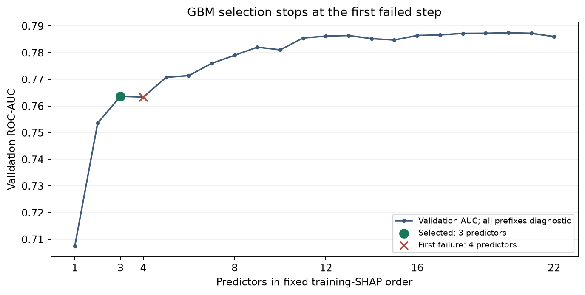
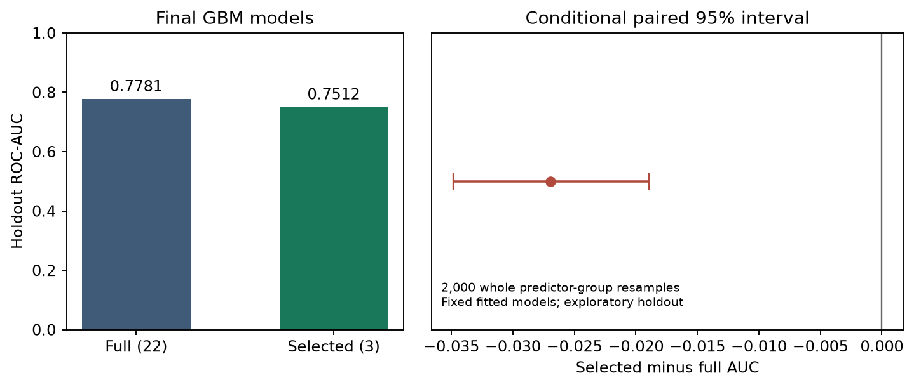
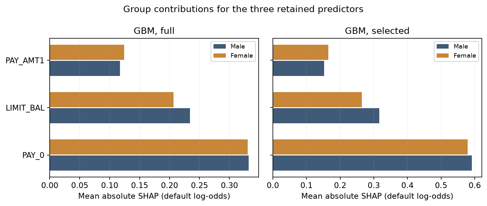

# Article methodology: results and remaining limitation

The implemented article-style GBM procedure selected **PAY_0, LIMIT_BAL, PAY_AMT1**. Its first-stop rule retained three predictors, but the final reduced model performed worse than the full GBM on this sample. The unpenalized article LR could not be estimated under our categorical design; its results remain explicitly unavailable. No categories were pooled and no regularized estimator was substituted into its tests.

## Model profiles

All four planned article roles are shown, followed by the existing LR reference. AP is sklearn average precision. Default recall and FPR use probability strictly greater than 0.50. Retained importance is the selected predictors' share of the **full model's** mean absolute SHAP importance.

| Model | Status | Predictors | AUC | AP | Brier | Default recall | FPR | Retained importance (%) |
| --- | --- | --- | --- | --- | --- | --- | --- | --- |
| Article LR, full | not estimable | 22 | Unavailable | Unavailable | Unavailable | Unavailable | Unavailable | Unavailable |
| Article LR, selected | not estimable | Unavailable | Unavailable | Unavailable | Unavailable | Unavailable | Unavailable | Unavailable |
| GBM, full | ok | 22 | 0.7781 | 0.5521 | 0.1350 | 0.3515 | 0.0507 | 100.0 |
| GBM, selected | ok | 3 | 0.7512 | 0.5079 | 0.1402 | 0.3447 | 0.0475 | 40.9 |
| Existing regularized LR (reference) | reference only | 22 | 0.7569 | 0.5270 | 0.1382 | 0.3545 | 0.0511 | Unavailable |

## What the selection did

Selection used 19,203 fitting records and 4,801 validation records from the saved training partition. The GBM order came from full-model training SHAP. Adding the fourth predictor, PAY_2, slightly decreased validation AUC, so the procedure stopped. Later prefixes recovered predictive performance, but did not reverse the first stop. The complete path is retained as a diagnostic. LR backward selection was not entered because its full fitting design was rank deficient; no successful LR selection is claimed.

Both GBMs were refitted on all 24,004 training records before evaluation on the same 5,996 holdout records. Selected-minus-full AUC was **-0.0270**, with a conditional paired group-bootstrap 95% interval **[-0.0348, -0.0190]**. The nominal paired DeLong p-value was 2.06e-11, or 8.24e-11 after Holm adjustment across the four planned comparisons, including the unavailable LR comparisons. The selected predictors retained **40.9%** of full-model mean absolute SHAP importance. These results quantify the cost of this particular reduction, not an overall SAFE winner.

## Explanation and group evidence

The GBM SHAP decompositions passed additivity checks. Both auxiliary regressions of the observed outcome on SHAP contributions were estimable. They are descriptive explanation tests, not predictive candidates or causal validation. Fairness tables give each predictor's group means, magnitude Gini, signed-effect audit and contribution-distribution KS. No fairness verdict or aggregate score is assigned. Contributions were recomputed for each fitted model, so the shared predictors' effects can change after reduction.

Read the [full group table](../evaluation/gbm_full_contribution_fairness.csv), [selected group table](../evaluation/gbm_selected_contribution_fairness.csv), [signed/absolute explanation-gap intervals](../evaluation/explanation_gap_intervals.csv), [decision metric gaps](../evaluation/group_metric_gaps.csv) and [full](../evaluation/gbm_full_shap_regression.csv)/[selected auxiliary regression](../evaluation/gbm_selected_shap_regression.csv) results. Signed gaps are female minus male. Low magnitude Gini indicates more equal contribution magnitudes; it does not establish fair decisions. KS assumes independent continuous observations, while these contributions have ties and predictor-group dependence; its p-values are nominal.

## What remains unavailable, and why

The full article LR design has 78 columns, including its intercept, but rank 74 on fitting data and rank 76 on complete training data. In particular, PAY_4=8, PAY_5=8 and PAY_6=8 occur for the same single training record. Other rare levels have only one outcome class, creating further estimability concerns. This prevents unique ordinary coefficient inference under the approved full-rank contract. It is not evidence that LR predicts poorly or that the article framework is inferior. The existing regularized LR remains an estimator reference, with no article likelihood tests attached.

The [discussion note](../../../../docs/plans/article_safe_lr_limitation_2026-10-10.md) explains the categorical coding, regularization distinction and comparison implications. The [saved diagnosis](../diagnostics/lr_design_identifiability.json) and [rare-level counts](../diagnostics/rare_repayment_indicator_support.csv) provide the training evidence. A coefficient-level KS procedure and an overall SAFE ranking are also not sufficiently specified in the original article; neither is invented here.

## How to use these results

The implementation supplies a reproducible article-based comparison branch with a visible LR limitation. It does not reproduce every unspecified author choice: GBM substitutes for the credit example's random forest; categorical coding, SHAP regression, Gini/KS targets and removal order follow the declared interpretation in the [specification](../../../../docs/plans/article_safe_specification_2026-10-10.md). The [fidelity table](article_fidelity.csv) distinguishes article procedures from interpretations and supporting diagnostics.

The original holdout was historically inspected, so these findings are exploratory. The 2,000 whole original-predictor-group bootstrap draws condition on fixed fits/subsets and do not include refitting or selection uncertainty. Full GBM reproduced the existing frozen GBM probabilities exactly. A fair later framework comparison should use shared candidate models and preprocessing where possible; changes of encoding or estimator need separate attribution. Any superiority claim requires a defined criterion and supporting experiments, rather than treating missing LR outputs as a win.

Saved [selection](../selection/stage_manifest.json) and [evaluation](../evaluation/stage_manifest.json) manifests record source/input/output identities. This report was generated only from those verified outputs; it did not refit models, change category treatment or rerun earlier research stages.
