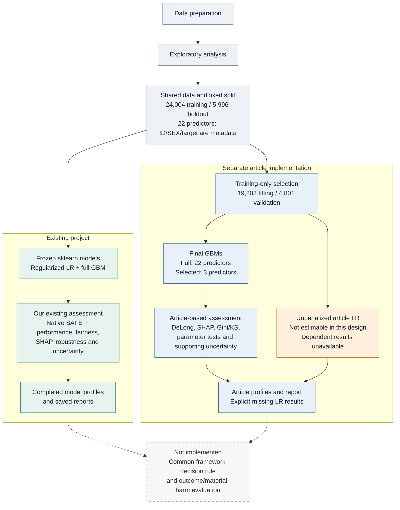

# Current project structure

10 October 2026. Solid arrows show the implemented workflow. Dashed arrows show the proposed common evaluation, which is not implemented. This describes the current project; it does not authorize a refactor or new experiment.

Both branches use the same cleaned records, original predictors, fixed outer partition and holdout. The original models/results were preserved. The article full GBM was fitted separately with the same settings and reproduced the original full GBM probabilities exactly. Its selected GBM is a genuinely different model, using PAY_0, LIMIT_BAL and PAY_AMT1. The original regularized LR is also present in the article report as a reference, without article likelihood tests.

Andrei's desired architecture is a shared candidate-model layer feeding both assessment frameworks, followed by a common measurable outcome criterion, potentially material harm. That final comparison is not implemented. The current structure has separate assessment branches, but also an article selection/fitting branch: variable selection is itself part of the article's proposed procedure. The LR estimator distinction and any future category pooling would require separate attribution before claiming framework superiority. Candidate models can be shared for assessment comparisons, while models produced by a framework's selection procedure still need evaluation as that procedure's outputs.

A new common model-selection/decision rule, material-harm definition and outcome experiment remain proposals. No pooling, model refitting or research-code change was performed while preparing this diagram.