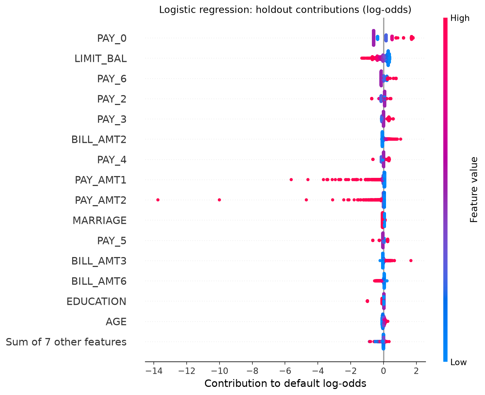
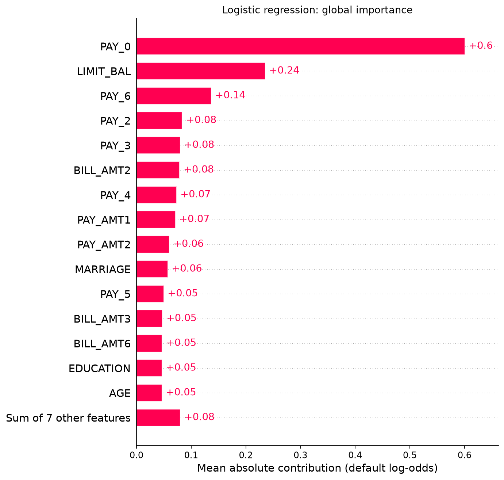
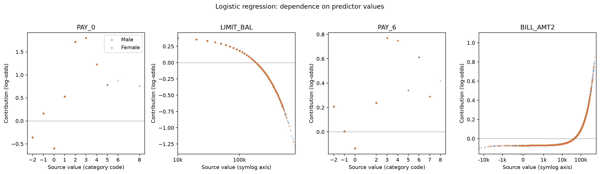
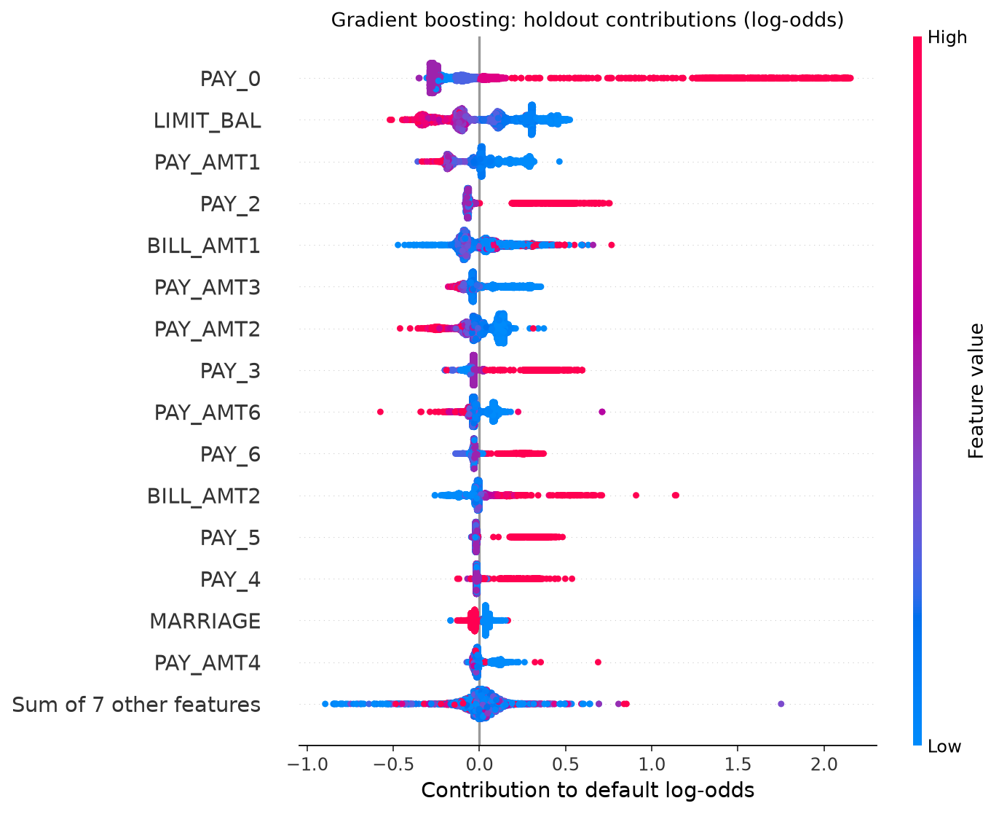
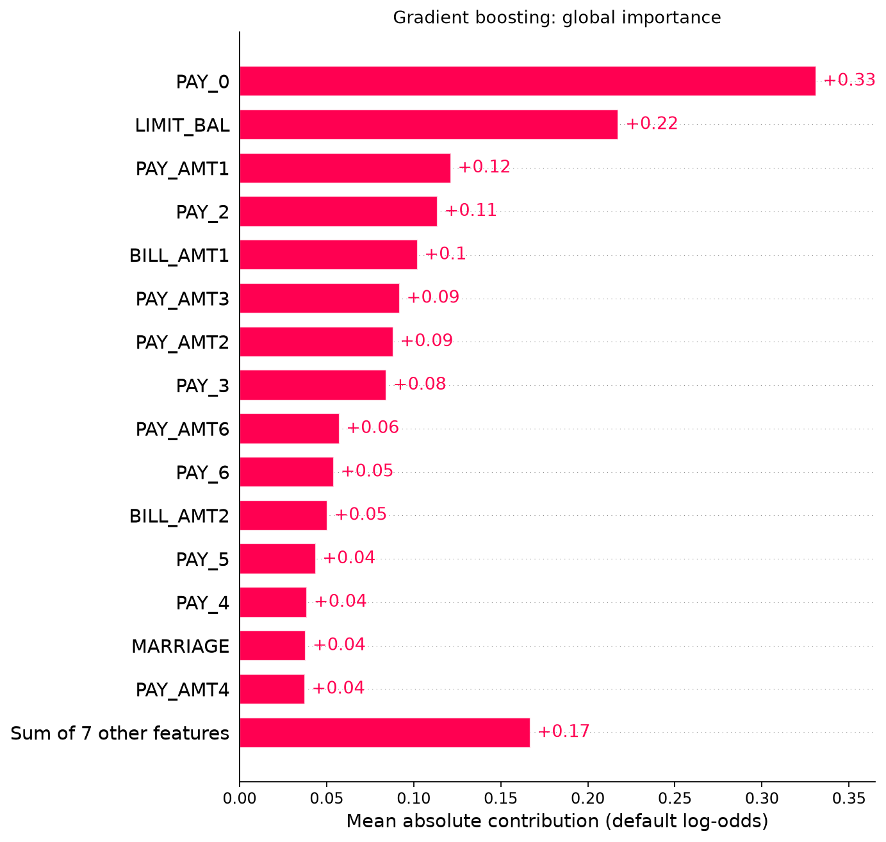
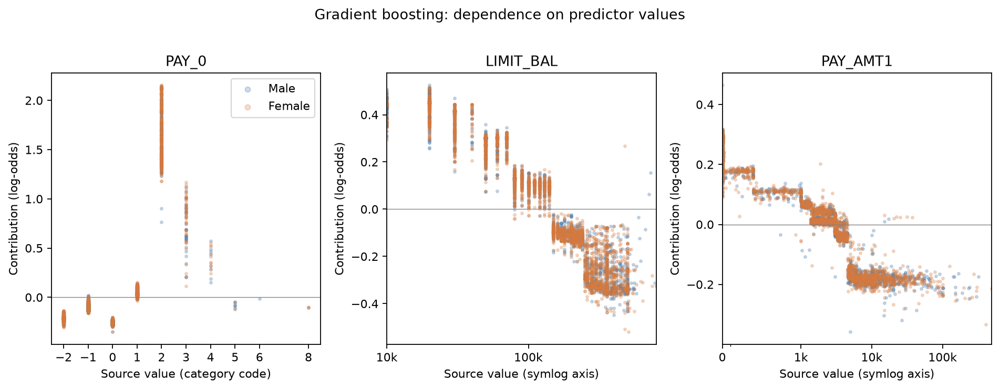
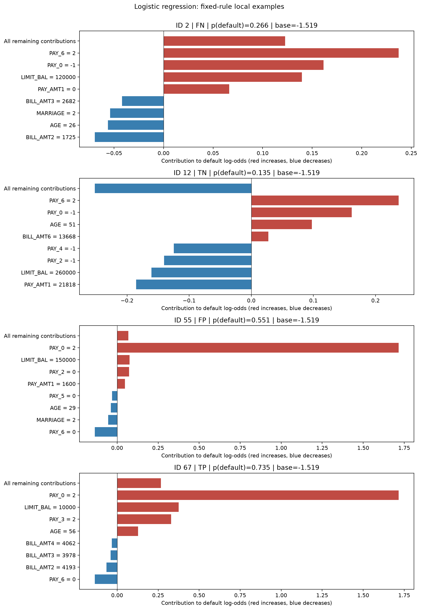
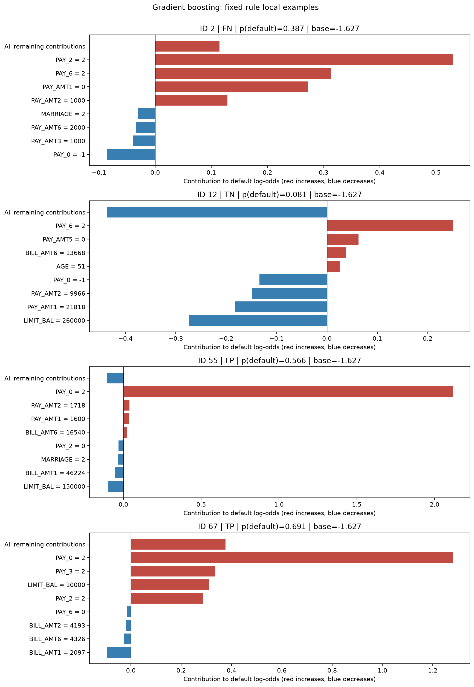
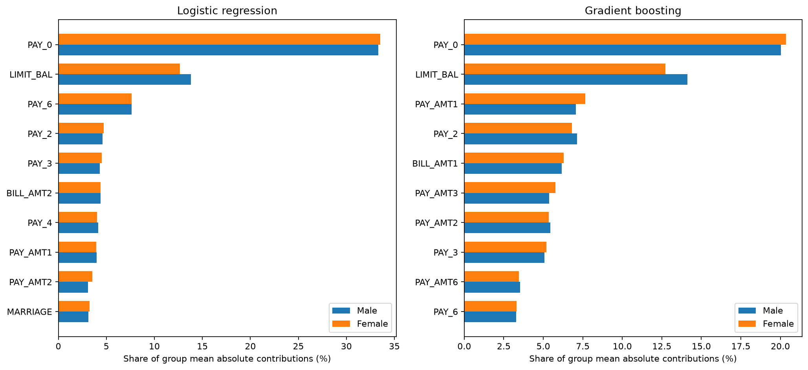
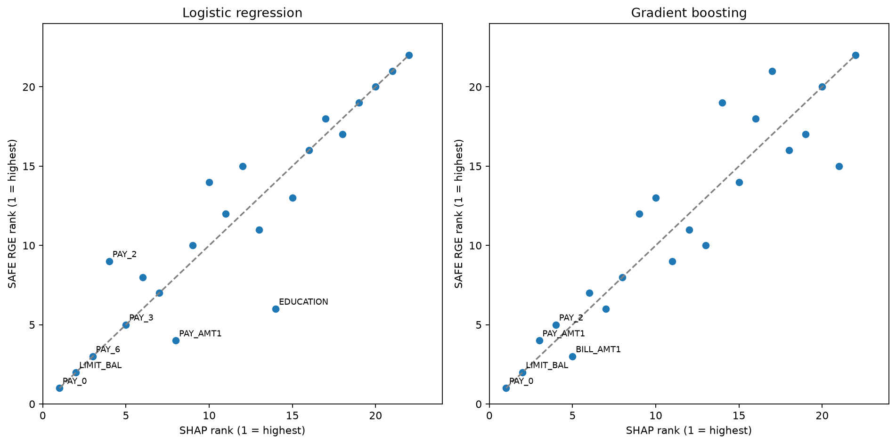

# Explainability Evaluation — frozen credit-risk models

## Methods and preserved protocol

The complete repaired holdout contains **5,996 records** (2,404 male, 3,592 female); training contains **24,004**. All original observations and the existing split are retained. The frozen logistic and gradient-boosting pipelines, preprocessing, 22 predictors and reference threshold **0.50** are unchanged. ID and SEX are metadata only. Class 1 is a default-risk flag; the saved sklearn decision rule assigns ties at 0.50 to class 0. No fitting, tuning, calibration, threshold selection or mitigation occurs.

### SHAP formulation

SHAP 0.51.0 uses **LinearExplainer** with an Independent masker for logistic regression and **TreeExplainer** with `feature_perturbation='interventional', model_output='raw'` for boosting. Both explain default **log-odds**, not probability points. One shared reference contains 100 training observations, sampled uniformly without replacement by NumPy `default_rng(42)` from training rows sorted by ID. No outcome or SEX stratification is used. IDs are saved in `background_metadata.csv`. The masker retains exactly these 100 rows without further subsampling. All 5,996 holdout rows are explained; none are background rows.

The frozen preprocessor creates 85 numerical/one-hot columns. SHAP is calculated on those columns, then signed contributions for all levels of each categorical predictor are summed before computing absolute importance. The result has 22 original predictor columns; transformed contributions and the full mapping are also saved. This preserves additivity, but for boosting it is **an aggregation of encoded-feature SHAP, not a separately computed original-feature coalition game**. Independent masking can break one-hot constraints and correlations. Linear additivity makes the categorical sum straightforward for logistic regression. Dependence plots use original values and show the top three predictors plus the two leading numeric predictors (at most five panels). Numeric axes use symlog scaling, so a straight numeric log-odds effect may look curved on that display. Category codes are not treated as a continuous scale; no meaning is invented for undocumented repayment codes.

The reconstruction identity is `base_value + sum(contributions) = decision_function(X)`; applying the logistic function recovers default probability. Positive contributions increase risk relative to the shared reference; negative ones decrease it. Averaging signed contributions is different from averaging their magnitudes.

| model | holdout_rows | original_features | transformed_features | max_margin_reconstruction_error | predictions_unchanged |
| --- | --- | --- | --- | --- | --- |
| logistic | 5996 | 22 | 85 | 5.329e-15 | True |
| gradient_boosting | 5996 | 22 | 85 | 8.044e-08 | True |

Implementation references: [SHAP LinearExplainer](https://shap.readthedocs.io/en/latest/generated/shap.LinearExplainer.html) and [TreeExplainer](https://shap.readthedocs.io/en/latest/generated/shap.TreeExplainer.html).

## Global explanation results

| model | feature | shap_rank | mean_abs_shap | mean_signed_shap | importance_share |
| --- | --- | --- | --- | --- | --- |
| logistic | PAY_0 | 1.00000 | 0.60057 | -0.05822 | 0.33435 |
| logistic | LIMIT_BAL | 2.00000 | 0.23547 | 0.03660 | 0.13109 |
| logistic | PAY_6 | 3.00000 | 0.13679 | -0.01267 | 0.07615 |
| logistic | PAY_2 | 4.00000 | 0.08379 | 0.02215 | 0.04665 |
| logistic | PAY_3 | 5.00000 | 0.07986 | 0.01347 | 0.04446 |
| gradient_boosting | PAY_0 | 1.00000 | 0.33104 | -0.00576 | 0.20221 |
| gradient_boosting | LIMIT_BAL | 2.00000 | 0.21761 | 0.03113 | 0.13292 |
| gradient_boosting | PAY_AMT1 | 3.00000 | 0.12139 | 0.01330 | 0.07415 |
| gradient_boosting | PAY_2 | 4.00000 | 0.11366 | 0.00091 | 0.06942 |
| gradient_boosting | BILL_AMT1 | 5.00000 | 0.10219 | 0.01141 | 0.06242 |

Importance shares divide each feature's mean absolute contribution by the model's total; they are descriptive concentration measures, not explained variance.

**Logistic regression:** PAY_0 leads with mean absolute SHAP 0.60057 log-odds (33.44% of total); top-three share is 54.16% and top-five share 63.27%.







**Gradient boosting:** PAY_0 leads with mean absolute SHAP 0.33104 log-odds (20.22% of total); top-three share is 40.93% and top-five share 54.11%.







## Local explanations

For each model and each TP/TN/FP/FN cell, select the **lowest original ID**, then explain the union with both models. This fixed rule uses outcome cells for illustration, without choosing explanation shapes or confidence levels. It is not a representative sample or evidence of model superiority. Selection reasons and eligible counts are saved separately. Each figure displays up to four strongest positive and four strongest negative contributions plus the signed remainder; all 22 contributions and source values are saved. Both models explain the same union of IDs.

| selection_model | selection_outcome | ID | eligible_records |
| --- | --- | --- | --- |
| logistic | TP | 67 | 468 |
| logistic | TN | 12 | 4437 |
| logistic | FP | 55 | 239 |
| logistic | FN | 2 | 852 |
| gradient_boosting | TP | 67 | 464 |
| gradient_boosting | TN | 12 | 4439 |
| gradient_boosting | FP | 55 | 237 |
| gradient_boosting | FN | 2 | 856 |


| model | ID | SEX | actual | predicted | probability_default | base_value |
| --- | --- | --- | --- | --- | --- | --- |
| logistic | 2 | 2 | 1 | 0 | 0.26640 | -1.51890 |
| logistic | 12 | 2 | 0 | 0 | 0.13492 | -1.51890 |
| logistic | 55 | 2 | 0 | 1 | 0.55052 | -1.51890 |
| logistic | 67 | 1 | 1 | 1 | 0.73523 | -1.51890 |
| gradient_boosting | 2 | 2 | 1 | 0 | 0.38688 | -1.62658 |
| gradient_boosting | 12 | 2 | 0 | 0 | 0.08108 | -1.62658 |
| gradient_boosting | 55 | 2 | 0 | 1 | 0.56610 | -1.62658 |
| gradient_boosting | 67 | 1 | 1 | 1 | 0.69113 | -1.62658 |






## SEX-group explanation patterns

Male = SEX 1; female = SEX 2. The same background and explainer are used for both groups; group comparisons are post hoc stratifications of the same holdout explanations. Ranked below are the five largest absolute **importance-share gaps** per model. All 22 features, raw magnitude gaps, signed means and group rankings are in the machine-readable table. A share difference of 0.01 is one percentage point. No materiality threshold or significance claim is imposed.

| model | feature | mean_abs_shap_male | mean_abs_shap_female | importance_share_female_minus_male | mean_signed_shap_female_minus_male | shap_rank_male | shap_rank_female |
| --- | --- | --- | --- | --- | --- | --- | --- |
| gradient_boosting | LIMIT_BAL | 0.23392 | 0.20670 | -0.01372 | -0.03162 | 2.00000 | 2.00000 |
| gradient_boosting | PAY_AMT1 | 0.11724 | 0.12417 | 0.00579 | 0.00890 | 4.00000 | 3.00000 |
| gradient_boosting | PAY_AMT3 | 0.08924 | 0.09382 | 0.00398 | 0.00128 | 7.00000 | 6.00000 |
| gradient_boosting | PAY_0 | 0.33212 | 0.33032 | 0.00322 | 0.00133 | 1.00000 | 1.00000 |
| gradient_boosting | PAY_2 | 0.11819 | 0.11062 | -0.00313 | -0.01085 | 3.00000 | 4.00000 |
| logistic | LIMIT_BAL | 0.25202 | 0.22440 | -0.01150 | -0.01231 | 2.00000 | 2.00000 |
| logistic | PAY_AMT2 | 0.05665 | 0.06301 | 0.00450 | -0.00606 | 10.00000 | 9.00000 |
| logistic | EDUCATION | 0.04361 | 0.04890 | 0.00368 | -0.00502 | 15.00000 | 11.00000 |
| logistic | PAY_3 | 0.07907 | 0.08039 | 0.00202 | -0.00849 | 6.00000 | 5.00000 |
| logistic | PAY_0 | 0.60913 | 0.59484 | 0.00176 | 0.00338 | 1.00000 | 1.00000 |


| model | sex_rank_spearman | sex_importance_share_total_variation |
| --- | --- | --- |
| logistic | 0.98645 | 0.01469 |
| gradient_boosting | 0.98532 | 0.02260 |

Total variation is half the sum of absolute gaps between normalized importance shares. It summarizes magnitude allocation, not fairness or harm. Raw log-odds magnitudes also reflect model score scale; normalization supports a complementary comparison.



For Logistic regression, the largest share gap is **LIMIT_BAL**, female minus male -1.150 percentage points. Its mean signed contribution differs by -0.01231 log-odds.

For Gradient boosting, the largest share gap is **LIMIT_BAL**, female minus male -1.372 percentage points. Its mean signed contribution differs by -0.03162 log-odds.

These differences describe model behavior combined with group feature distributions. They do not identify a causal SEX effect or establish discrimination. Read them alongside the completed fairness audit, which reports different model orderings for ranking parity and threshold-specific error gaps. Practical materiality remains undecided.

## Actual SAFE Rank Graduation Explainability

The unmodified installed **safeaipackage 0.8.3** function `safeaipackage.check_explainability.compute_rge_values(xtrain, xtest, yhat, model, variables, group=False)` is called for all 22 original predictors. Here `yhat` is the frozen model's full-holdout default probability, **not the outcome**. For each feature the package replaces its holdout values by a training reference, recomputes probabilities through the unchanged pipeline, and returns **1 − core.rga(original_probabilities, replaced_probabilities)**. RGA compares the ordering after replacement against the original scores, with a score-magnitude-weighted graduation construction and package tie handling. It is not Spearman correlation, SHAP or a drop in outcome ROC-AUC. Larger RGE means greater change in the model's score ordering under this replacement.

The package uses training means for numeric columns and training modes for pandas categorical columns (first sorted mode on ties). The eight existing categorical predictors are explicitly represented as pandas Categoricals using the fitted encoder's categories. This communicates the original preprocessing semantics to SAFE without changing any values or fitted transformers. Full training and holdout probabilities are checked for exact equality before and after dtype conversion. No SEX column is passed. Training reference values are saved. Passing raw integer category codes instead would make SAFE average them and could invoke unknown one-hot categories; that inappropriate alternative is not used.

With `group=True`, each member of a logical group is replaced in turn before one joint RGE is returned. The groups partition the 22 predictors: six repayment statuses, six bill amounts, six payment amounts, and LIMIT_BAL/AGE/EDUCATION/MARRIAGE. Grouped values need not equal sums of individual values. Computation is deterministic; no permutation seed or refitting is involved.

| model | feature | RGE | rge_rank |
| --- | --- | --- | --- |
| logistic | PAY_0 | 0.11784 | 1.00000 |
| logistic | LIMIT_BAL | 0.02304 | 2.00000 |
| logistic | PAY_6 | 0.00715 | 3.00000 |
| logistic | PAY_AMT1 | 0.00323 | 4.00000 |
| logistic | PAY_3 | 0.00312 | 5.00000 |
| logistic | EDUCATION | 0.00285 | 6.00000 |
| logistic | PAY_4 | 0.00258 | 7.00000 |
| gradient_boosting | PAY_0 | 0.05623 | 1.00000 |
| gradient_boosting | LIMIT_BAL | 0.01635 | 2.00000 |
| gradient_boosting | BILL_AMT1 | 0.00961 | 3.00000 |
| gradient_boosting | PAY_AMT1 | 0.00505 | 4.00000 |
| gradient_boosting | PAY_2 | 0.00422 | 5.00000 |
| gradient_boosting | PAY_AMT2 | 0.00370 | 6.00000 |
| gradient_boosting | PAY_AMT3 | 0.00361 | 7.00000 |


| model | group | features | RGE |
| --- | --- | --- | --- |
| logistic | repayment_status | PAY_0,PAY_2,PAY_3,PAY_4,PAY_5,PAY_6 | 0.24322 |
| logistic | bill_amounts | BILL_AMT1,BILL_AMT2,BILL_AMT3,BILL_AMT4,BILL_AMT5,BILL_AMT6 | 0.00386 |
| logistic | payment_amounts | PAY_AMT1,PAY_AMT2,PAY_AMT3,PAY_AMT4,PAY_AMT5,PAY_AMT6 | 0.00859 |
| logistic | background_and_credit_limit | LIMIT_BAL,AGE,EDUCATION,MARRIAGE | 0.02812 |
| gradient_boosting | repayment_status | PAY_0,PAY_2,PAY_3,PAY_4,PAY_5,PAY_6 | 0.18267 |
| gradient_boosting | bill_amounts | BILL_AMT1,BILL_AMT2,BILL_AMT3,BILL_AMT4,BILL_AMT5,BILL_AMT6 | 0.01314 |
| gradient_boosting | payment_amounts | PAY_AMT1,PAY_AMT2,PAY_AMT3,PAY_AMT4,PAY_AMT5,PAY_AMT6 | 0.06273 |
| gradient_boosting | background_and_credit_limit | LIMIT_BAL,AGE,EDUCATION,MARRIAGE | 0.01869 |

The installed explainability module, core and utility sources were inspected and hashed; package provenance is in the run manifest. The earlier SAFE adapter documents an inspected upstream commit for core/fairness utilities. This stage makes no claim that the new explainability module was verified byte-for-byte against that GitHub commit; the remote file could not be retrieved. The installed module is the authentic package implementation, not a local formula replacement. [SAFE repository and function documentation](https://github.com/GolnooshBabaei/safeaipackage).

## SHAP versus SAFE RGE

| model | shap_rge_spearman |
| --- | --- |
| logistic | 0.91756 |
| gradient_boosting | 0.92660 |

Spearman correlations use all 22 feature ranks with average ranks for ties; no p-values or inferential claims are made. SHAP averages absolute additive log-odds contributions relative to a sampled background. SAFE RGE examines score-order disruption when a feature is fixed to one full-training mean/mode. They use different reference operations and output concepts; RGE is unsigned and cannot supply local contribution direction. Neither ranking is a causal effect.

**Logistic regression:** top-five overlap 4/5 (PAY_0, LIMIT_BAL, PAY_6, PAY_3). RGE top five: PAY_0, LIMIT_BAL, PAY_6, PAY_AMT1, PAY_3. Largest rank disagreements:

| feature | shap_rank | rge_rank | mean_abs_shap | RGE |
| --- | --- | --- | --- | --- |
| EDUCATION | 14.00000 | 6.00000 | 0.04678 | 0.00285 |
| PAY_2 | 4.00000 | 9.00000 | 0.08379 | 0.00204 |
| PAY_AMT1 | 8.00000 | 4.00000 | 0.07116 | 0.00323 |
**Gradient boosting:** top-five overlap 5/5 (PAY_0, LIMIT_BAL, PAY_AMT1, PAY_2, BILL_AMT1). RGE top five: PAY_0, LIMIT_BAL, BILL_AMT1, PAY_AMT1, PAY_2. Largest rank disagreements:

| feature | shap_rank | rge_rank | mean_abs_shap | RGE |
| --- | --- | --- | --- | --- |
| EDUCATION | 21.00000 | 15.00000 | 0.01485 | 0.00095 |
| MARRIAGE | 14.00000 | 19.00000 | 0.03804 | 0.00066 |
| BILL_AMT6 | 17.00000 | 21.00000 | 0.02918 | 0.00049 |



Replacement effects can be small despite large additive contributions if ordering is preserved or correlated variables retain similar information. Conversely, moving everyone to one particular training reference can change ordering more than mean absolute background-centered attribution suggests. Encoded-feature aggregation is another source of disagreement for boosting.

## Model comparison and effect direction

| model | top1_shap_share | top3_shap_share | top5_shap_share | total_mean_abs_shap |
| --- | --- | --- | --- | --- |
| logistic | 0.33435 | 0.54160 | 0.63271 | 1.79622 |
| gradient_boosting | 0.20221 | 0.40928 | 0.54113 | 1.63713 |

On the top-three normalized SHAP-share measure, **Logistic regression is more concentrated**. On total variation of SEX-group importance shares, **Gradient boosting has the larger group difference**. These are descriptive choices of summary, not an overall explainability or fairness winner.

The models share 3/5 leading SHAP predictors: PAY_0, LIMIT_BAL, PAY_2. The dependence plots show higher credit limits contributing lower default log-odds in both models. For boosting, PAY_AMT1 generally contributes less risk at higher payments, with steps and context-dependent spread. These are fitted-model patterns relative to the selected background, not lending recommendations.

For PAY_0, selected observed code-level contributions are:

| model | value | records | mean_signed_shap | min_shap | max_shap |
| --- | --- | --- | --- | --- | --- |
| logistic | 0 | 2956 | -0.60011 | -0.60011 | -0.60011 |
| logistic | 1 | 685 | 0.52705 | 0.52705 | 0.52705 |
| logistic | 2 | 529 | 1.71668 | 1.71668 | 1.71668 |
| gradient_boosting | 0 | 2956 | -0.26418 | -0.35205 | -0.19859 |
| gradient_boosting | 1 | 685 | 0.05554 | -0.03748 | 0.15329 |
| gradient_boosting | 2 | 529 | 1.64664 | 0.76304 | 2.15350 |

The logistic model is additive and linear in its scaled numeric inputs, but its one-hot categorical effects are already category-specific, not linear in numeric category codes. At a fixed category its summed categorical SHAP effect is constant. Boosting can have differing contributions at the same source value because its tree context involves other features; the reported ranges and dependence panels expose that context dependence. Numeric tree effects can be stepwise and non-linear, where logistic numeric effects are straight lines in untransformed source units. These plots are descriptive, not interaction tests or causal response curves.

## Limitations and research implications

The analysis characterizes these two fitted models on one historically inspected holdout. It does not establish population generalization, statistical significance or practical materiality of rank or group differences. No SHAP/RGE confidence intervals are calculated. Correlated repayment, billing and payment histories make attribution reference-dependent. The 100-row training background is reproducible but its sampling uncertainty has not been explored. Holdout group composition can explain mean contribution differences without a direct SEX input. Global averages can hide individual variation and signed cancellation.

SAFE mean/mode replacement can create unrealistic combinations, and a small RGE can coexist with substantial probability-level changes that preserve ordering. Grouped RGE is not additive. The original probabilities enter RGA as continuous reference scores, so the fairness-stage observation that binary-outcome RGA matched AUC does not apply here. SHAP uses an additive log-odds scale and aggregated dummy contributions; neither method alone establishes human comprehensibility, fairness, a causal effect or a feature-removal recommendation. Local examples are illustrations selected by a fixed ID rule. Historical Taiwanese data and binary source SEX encoding limit wider interpretation.

For the paper, this stage adds reproducible feature rankings, score-contribution direction, local error examples, group explanation patterns, and a documented comparison of additive attribution with SAFE ranking disruption. It complements performance and fairness evidence without collapsing them into one winner.

**Exact next research stage: Robustness evaluation**, with a separately specified SAFE RGR protocol and defensible feature perturbations. No robustness experiment has been run here. Stability/PSI/monitoring follows later; mitigation, proxy follow-up, intersectionality and governance remain future work.

## Reproduction, inputs and artifacts

Run from the repository root (or invoke the script by absolute path):

```powershell
.venv\Scripts\python.exe -m pip install -r requirements-explainability.txt
.venv\Scripts\python.exe script_explainability_evaluation.py --verify
```

Reused inputs: `data/processed/taiwan_credit_clean.csv`, persisted split metadata and preparation manifest; `models/baseline_logistic.joblib` and `models/baseline_gradient_boosting.joblib` plus manifests; both baseline prediction CSVs; performance/fairness run manifests; fairness `group_summary.csv`; shared utilities in `src/baseline.py`, `src/performance_evaluation.py`, `src/fairness_evaluation.py`, and SAFE provenance from `src/safe_adapter.py`. Raw data, processed data, models and prior performance/fairness artifacts are protected by hashes.

New code: `src/explainability_evaluation.py`, `src/explainability_report.py`, `script_explainability_evaluation.py`, `tests/test_explainability_evaluation.py`, and `requirements-explainability.txt`. Tables under `outputs/tables/explainability_evaluation/` contain original and transformed SHAP values, column mappings, global and SEX-specific importance, group comparisons, local examples, categorical effects, RGE and grouped RGE, cross-method/model comparisons, reconstruction checks, and prediction audit. Figures are saved as PNG/SVG.

`run_manifest.json` records settings, environment versions, inspected SAFE source hashes, protected artifact hashes, source hashes and output hashes. `--verify` executes two complete runs, requires byte-identical CSVs (including RGE), and runs the complete test suite. Its results and test log are stored in `verification.json` and `test_results.txt`. Read numerical CSVs using `float_precision='round_trip'` for exact probability comparisons.
