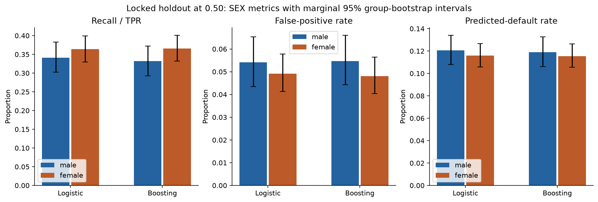
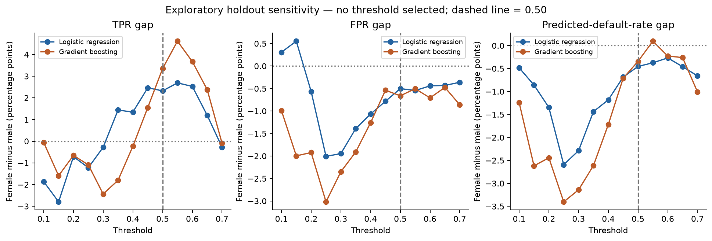
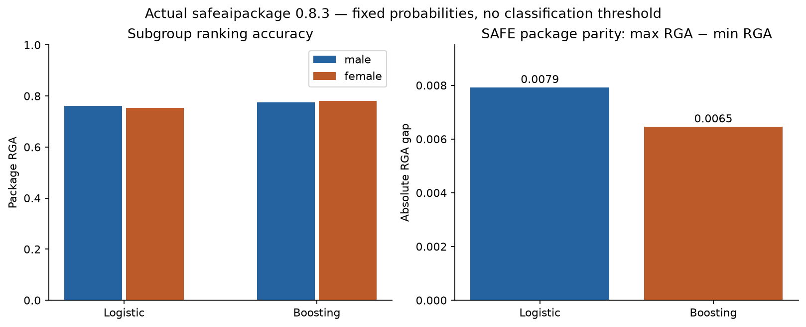

# Fairness Evaluation — fixed credit-risk baselines

## Scope and conventions

Both stabilized fitted pipelines, all 22 predictors, and the repaired 24,004/5,996
partition are unchanged. No model training, tuning, calibration or mitigation took
place. Primary threshold = **0.50**, with class 1 when probability > 0.50 and ties
assigned class 0, as in the existing baselines. SEX=1 means male, SEX=2 female;
SEX and ID never enter either pipeline's predictor matrix.

Here, a positive prediction means **flagged as likely to default**, an adverse-risk
flag rather than a favorable credit approval. 'Selection rate' means predicted-default
rate only. Which decisions/harms matter requires an explicit lending-policy context.
All signed gaps are **female minus male**. Ratios are labeled explicitly: female/male
for selection-rate ratio, min/max for demographic-parity ratio. Demographic-parity
difference is the conventional unsigned max-minus-min rate; the signed version is
selection_rate_difference. No legal threshold or 80% rule is used.

## 1. Protected-group composition

| SEX | group | records | defaults | non_defaults | observed_default_rate | holdout_percentage |
| --- | --- | --- | --- | --- | --- | --- |
| 1 | male | 2404 | 557 | 1847 | 0.2317 | 40.0934 |
| 2 | female | 3592 | 763 | 2829 | 0.2124 | 59.9066 |

These are observed sample default rates, not inherent characteristics of either
group. Base-rate differences can affect precision and selection rates even when
other error-rate measures are similar.

## 2. Group metrics at 0.50

Rows of each confusion matrix are actual [0,1], columns predicted [0,1]:
`[[TN, FP], [FN, TP]]`. All counts and rates are in `group_metrics_threshold_050.csv`.

| model | group | records | defaults | predicted_positives | TN | FP | FN | TP |
| --- | --- | --- | --- | --- | --- | --- | --- | --- |
| logistic | male | 2404.0000 | 557.0000 | 290.0000 | 1747.0000 | 100.0000 | 367.0000 | 190.0000 |
| logistic | female | 3592.0000 | 763.0000 | 417.0000 | 2690.0000 | 139.0000 | 485.0000 | 278.0000 |
| gradient_boosting | male | 2404.0000 | 557.0000 | 286.0000 | 1746.0000 | 101.0000 | 372.0000 | 185.0000 |
| gradient_boosting | female | 3592.0000 | 763.0000 | 415.0000 | 2693.0000 | 136.0000 | 484.0000 | 279.0000 |

| model | group | selection_rate | accuracy | balanced_accuracy | precision | recall | specificity | fpr | fnr | npv | f1 |
| --- | --- | --- | --- | --- | --- | --- | --- | --- | --- | --- | --- |
| logistic | male | 0.1206 | 0.8057 | 0.6435 | 0.6552 | 0.3411 | 0.9459 | 0.0541 | 0.6589 | 0.8264 | 0.4486 |
| logistic | female | 0.1161 | 0.8263 | 0.6576 | 0.6667 | 0.3644 | 0.9509 | 0.0491 | 0.6356 | 0.8472 | 0.4712 |
| gradient_boosting | male | 0.1190 | 0.8032 | 0.6387 | 0.6469 | 0.3321 | 0.9453 | 0.0547 | 0.6679 | 0.8244 | 0.4389 |
| gradient_boosting | female | 0.1155 | 0.8274 | 0.6588 | 0.6723 | 0.3657 | 0.9519 | 0.0481 | 0.6343 | 0.8477 | 0.4737 |

Undefined ratios or rates have missing values, rather than invented zero values.
At this sample size the reported primary point estimates are defined.

## 3. Demographic parity, equal opportunity and equalized odds

Demographic parity compares predicted-default rates. Equal opportunity is assessed
for the dataset's positive label (default detection) by comparing recall/TPR.
Equalized odds compares both TPR and FPR. The maximum of their two absolute gaps
is also reported, but both components remain visible.
[Conventional definitions](https://fairlearn.org/main/user_guide/assessment/common_fairness_metrics.html).

| model | selection_rate_difference | selection_rate_ratio_female_to_male | recall_difference | fpr_difference | equalized_odds_max_absolute_gap | safe_RGA_female_minus_male | SAFE_absolute_parity_gap |
| --- | --- | --- | --- | --- | --- | --- | --- |
| gradient_boosting | -0.0034 | 0.9711 | 0.0335 | -0.0066 | 0.0335 | 0.0065 | 0.0065 |
| logistic | -0.0045 | 0.9624 | 0.0232 | -0.0050 | 0.0232 | -0.0079 | 0.0079 |

For recall_difference, the absolute sample gap is 0.02324 for logistic and 0.03353 for boosting; gradient boosting has the larger value. For fpr_difference, the absolute sample gap is 0.00501 for logistic and 0.00661 for boosting; gradient boosting has the larger value. For selection_rate_difference, the absolute sample gap is 0.00454 for logistic and 0.00343 for boosting; logistic regression has the larger value. For SAFE_absolute_parity_gap, the absolute sample gap is 0.00792 for logistic and 0.00646 for boosting; logistic regression has the larger value.

Closer to zero means closer observed parity for the particular difference metric,
and closer to one means closer parity for the specified ratios. Neither numerical
comparison establishes overall fairness or discrimination. No materiality tolerance
has been specified, and no between-model significance test has been conducted.

Important signed differences and marginal 95% intervals (proportions, not percentages):

| model | metric | estimate | ci_lower | ci_upper |
| --- | --- | --- | --- | --- |
| logistic | selection_rate_difference | -0.0045 | -0.0215 | 0.0121 |
| logistic | precision_difference | 0.0115 | -0.0612 | 0.0846 |
| logistic | recall_difference | 0.0232 | -0.0290 | 0.0775 |
| logistic | specificity_difference | 0.0050 | -0.0079 | 0.0188 |
| logistic | fpr_difference | -0.0050 | -0.0188 | 0.0079 |
| logistic | fnr_difference | -0.0232 | -0.0775 | 0.0290 |
| gradient_boosting | selection_rate_difference | -0.0034 | -0.0203 | 0.0131 |
| gradient_boosting | precision_difference | 0.0254 | -0.0454 | 0.0999 |
| gradient_boosting | recall_difference | 0.0335 | -0.0168 | 0.0864 |
| gradient_boosting | specificity_difference | 0.0066 | -0.0062 | 0.0197 |
| gradient_boosting | fpr_difference | -0.0066 | -0.0197 | 0.0062 |
| gradient_boosting | fnr_difference | -0.0335 | -0.0864 | 0.0168 |
| logistic | safe_rga_difference | -0.0079 | -0.0392 | 0.0229 |
| gradient_boosting | safe_rga_difference | 0.0065 | -0.0228 | 0.0361 |

The CSV includes CIs for every group-specific rate, conventional gap/ratio, group
RGA and signed/absolute RGA gaps. Use these intervals to describe uncertainty;
small nonzero sample differences alone do not establish a population disparity.
Where a signed interval includes zero, it is compatible with either direction at
this precision. An interval excluding zero still does not establish causation or
practical significance, especially with multiple exploratory metrics.

For these fixed baselines, the selection-rate, TPR, FPR and signed RGA-gap intervals
all include zero. This audit therefore does not resolve their population directions
at the reported marginal interval precision. It is not evidence of equivalence or
proof that practically important disparities are absent.

## 4. Group-aware uncertainty

**2,000 replicates, NumPy default_rng(42)**. Resample the number of distinct
holdout exact-predictor groups with replacement, including every record in each
sampled group at its group multiplicity. Groups are defined on the same 22 predictors,
excluding ID, SEX and target. A group containing both SEX codes remains intact:
resampling is not done independently by SEX. Both models use the same resamples.
Use integer row weights for confusion metrics and explicitly expanded sampled
records with the actual package `rga` for SAFE bootstrap metrics.

Intervals are 2.5th/97.5th percentiles, linear interpolation. Undefined estimates
are excluded metric by metric; valid/undefined replicate counts are saved.
These are marginal, unadjusted intervals, conditional on the fixed models and
observed groups. They omit retraining, model-selection and future-shift uncertainty.
No model-difference test, multiplicity correction or causal-discrimination test is
performed. Absolute-gap intervals are nonnegative by construction and must not be
interpreted as evidence of disparity merely because their lower endpoint exceeds
zero; use signed-gap intervals for direction and uncertainty.

## 5. Exploratory holdout threshold sensitivity

This stage explicitly authorizes **descriptive** sensitivity at 0.10–0.70 in 0.05
steps. This extends the earlier stage's fixed-threshold holdout reporting, not its
prohibition on holdout-based development. No threshold is selected, recommended
as optimal, or applied to model artifacts. The 0.50 reference remains fixed.

| model | gap_female_minus_male | minimum | maximum | sign_changes_on_grid |
| --- | --- | --- | --- | --- |
| logistic | recall_difference | -0.0280 | 0.0269 | True |
| logistic | fpr_difference | -0.0201 | 0.0055 | True |
| logistic | selection_rate_difference | -0.0259 | -0.0027 | False |
| gradient_boosting | recall_difference | -0.0244 | 0.0462 | True |
| gradient_boosting | fpr_difference | -0.0302 | -0.0047 | False |
| gradient_boosting | selection_rate_difference | -0.0340 | 0.0010 | True |

These ranges describe changes in gaps across the common grid; sign changes indicate
that even the direction can depend on threshold. The CSV additionally reports overall
recall/precision/positive rate and both groups' TPR, FPR and selection rates at every
grid value. Magnitudes and model ordering can change without changes to the underlying
scores. These exploratory curves have no simultaneous confidence bands, and must
not be mined for a favorable threshold or used for a new operating choice.

On this grid, TPR-gap direction changes for both models. Logistic's FPR gap also
changes sign, while boosting's remains negative (lower female FPR). Logistic's
selection-rate gap remains negative, while boosting's crosses zero. The apparent
direction is therefore not stable across all thresholds and metrics.

## 6. Actual SAFE RGA and parity

| model | group | records | RGA | ROC-AUC | Average Precision (AP) |
| --- | --- | --- | --- | --- | --- |
| logistic | overall | 5996 | 0.7569 | 0.7569 | 0.5270 |
| logistic | male | 2404 | 0.7613 | 0.7613 | 0.5286 |
| logistic | female | 3592 | 0.7534 | 0.7534 | 0.5285 |
| gradient_boosting | overall | 5996 | 0.7781 | 0.7781 | 0.5521 |
| gradient_boosting | male | 2404 | 0.7741 | 0.7741 | 0.5414 |
| gradient_boosting | female | 3592 | 0.7805 | 0.7805 | 0.5631 |

| model | male_RGA | female_RGA | female_minus_male | package_parity |
| --- | --- | --- | --- | --- |
| logistic | 0.7613 | 0.7534 | -0.0079 | 0.0079 |
| gradient_boosting | 0.7741 | 0.7805 | 0.0065 | 0.0065 |

Results use **safeaipackage 0.8.3**, without locally replacing its
RGA formula or parity implementation. The package describes RGA as normalized
agreement between outcome and predicted-score rankings, with higher values better;
its rank-graduation framework also addresses nonbinary outcomes. Here, numerical
agreement of returned RGA with ROC-AUC within 1e-12 is **True**. This is recorded
as a finding of this binary-outcome implementation, not an assumption that the
metrics are interchangeable for other tasks. AP remains a distinct metric.

SAFE parity is the package's **max(group RGA) − min(group RGA)**, so zero is exact
sample parity and the return value is unsigned. Its source returns a sentence,
which is preserved verbatim in `safe_rga_parity.csv`; only its numeric value is
parsed for tables. Signed female-minus-male group RGA is reported separately.

The adapter supplies SAFE a dataframe containing 22 predictors plus SEX. On every
prediction it selects only the saved pipeline's feature names, in their original
order, rejecting unexpected columns. It advertises sklearn classifier tags and
delegates predict/predict_proba to the frozen pipeline; fit is prohibited. Full
and subgroup predictions reproduce the original probabilities. SAFE enumerates
groups using training SEX value counts, resets input indices, and recomputes subgroup
probabilities; supplied yhat is validated but not used for subgroup scoring. Inputs
are aligned positionally before the call. No privileged/unprivileged label is assigned:
the source simply computes max-minus-min regardless of enumeration order.

Inspected GitHub commit: `1e5f2a84d183c741fecaa682f2b9d496c142bd45`. Installed core
matches exactly; fairness/utilities differ only in whitespace/newline. The installed
distribution does not record a Git commit, so the inspected commit is not presented
as installation provenance. Version and actual source SHA-256 hashes are in the run
manifest. The upstream example recodes its own gender column to 0/1; our audit retains
the dataset's 1/2 coding, which the function supports. No package patch was needed.
The distribution declares no dependencies although fairness/core utilities import
CatBoost and XGBoost; these and their missing pinned dependency closure are included
in `requirements-fairness.txt`, leaving the previous requirements lock unchanged.

[SAFE repository and framework](https://github.com/GolnooshBabaei/safeaipackage),
[inspected parity source](https://github.com/GolnooshBabaei/safeaipackage/blob/1e5f2a84d183c741fecaa682f2b9d496c142bd45/safeaipackage/check_fairness.py),
[inspected core](https://github.com/GolnooshBabaei/safeaipackage/blob/1e5f2a84d183c741fecaa682f2b9d496c142bd45/safeaipackage/core.py).

## 7. Conventional versus SAFE interpretation

The table in section 3 keeps framework results side by side rather than forcing
agreement. SAFE evaluates disparity in **within-group ranking accuracy across the
scores**, independent of a classification threshold. It does not measure parity
of the fraction flagged, missed defaults or false alarms at a particular decision
boundary. Conventional TPR/FPR/selection-rate metrics capture those decision outcomes,
but do not describe the quality of the entire ranking.

Gradient boosting retains its previously established overall ranking advantage.
Whether it has a larger fairness gap depends on the chosen metric and threshold;
the absolute gaps listed above are the relevant descriptive evidence. A ranking
advantage is not proof of a fairness advantage. Disagreement in gap direction or
model ordering between frameworks is a substantive result, not automatically an
implementation error. A claim of a meaningful difference additionally needs an
agreed practical tolerance and appropriate comparative uncertainty analysis.

The substantive disagreement here is that boosting has a **smaller SAFE ranking
parity gap but larger TPR/FPR absolute gaps at 0.50**. Its selection-rate gap is
smaller. Logistic has lower female subgroup RGA but higher female TPR at 0.50;
for boosting, female subgroup RGA and TPR are both higher. These are point-estimate
comparisons with uncertainty, not proof that either model is overall fairer.

## 8. Unawareness and descriptive predictor associations

Excluding SEX prevents its direct use but **does not prove fairness**. Predictor
associations can remain. Descriptive analysis uses only the existing training data,
with no feature selection, removal, proxy classifier or retraining.

Largest numeric associations (ranked within numeric features only):

| feature | association | signed_standardized_mean_difference_female_minus_male | male_mean | female_mean | male_median | female_median |
| --- | --- | --- | --- | --- | --- | --- |
| AGE | 0.1902 | -0.1902 | 36.4872 | 34.7382 | 35.0000 | 33.0000 |
| BILL_AMT1 | 0.0692 | -0.0692 | 54193.9558 | 49065.8340 | 24127.0000 | 21174.5000 |
| BILL_AMT2 | 0.0645 | -0.0645 | 51788.3977 | 47185.6123 | 22694.0000 | 20382.0000 |
| BILL_AMT3 | 0.0530 | -0.0530 | 49062.9013 | 45411.4600 | 20542.5000 | 19565.0000 |
| LIMIT_BAL | 0.0519 | 0.0519 | 163249.2619 | 170025.8953 | 130000.0000 | 150000.0000 |

Largest categorical associations (ranked within categorical features only):

| feature | association |
| --- | --- |
| PAY_2 | 0.0794 |
| PAY_3 | 0.0759 |
| PAY_0 | 0.0712 |
| PAY_4 | 0.0704 |
| PAY_5 | 0.0627 |

Numeric effect size = (female mean − male mean) / sqrt((male sample variance +
female sample variance)/2), with its absolute value used for ordering. Means,
medians and quartiles are provided for skewed financial distributions. Categorical
effect size is uncorrected Cramer's V = sqrt(chi-square / (N × min(r−1,c−1))),
without continuity correction; category counts/fractions are saved separately.
Numeric SMD and Cramer's V are different scales and are not pooled into one ranking.
These are descriptive effect sizes, with no p-value screening or arbitrary cutoff
used to label a predictor a proxy. Associations may reflect sample composition and
do not establish prohibited proxy use, a causal pathway, or unlawful discrimination.
Full causal/proxy investigation would require a separately agreed methodology.

## 9. Intersectionality readiness and next decisions

SEX × age bands, SEX × education and SEX × marriage could support a later study.
Before computing intersectional fairness, inspect each cell's total/default/non-default
counts and effective predictor-group counts, define handling of small cells and
multiple comparisons, and agree age bands in advance. No intersectional fairness
experiment is performed here.

Limitations include one already-inspected holdout, fixed-model conditional intervals,
exact-group dependence handling rather than complete independence guarantees,
multiple descriptive metrics, threshold-grid exploration, binary source SEX coding,
and historical Taiwanese sample representativeness. There is no defined materiality
tolerance, operational approval rule, utility/cost function or causal identification.

Before the next stage, agree which decision harms and fairness concepts matter,
what gap is practically material, and how to handle potentially competing criteria.
Retain 0.50 unless a separately agreed **training-only** protocol chooses otherwise;
these holdout sensitivity results cannot choose it. Decide whether a focused proxy
or intersectional follow-up is needed and approve its design first. Both models remain.
No mitigation, SHAP/RGE, RGR/robustness, PSI or governance monitoring has begun.

## Reproduction and files

Install the extension with `python -m pip install -r requirements-fairness.txt`, then
run `python script_fairness_evaluation.py`. Read probability CSVs with
`float_precision="round_trip"`. Notebook `06_fairness_evaluation.ipynb` verifies
and displays saved results without fitting models. Run `python -m unittest discover
-s tests -v` for focused checks.

Created: `src/safe_adapter.py`, `src/fairness_evaluation.py`, `src/fairness_report.py`,
`script_fairness_evaluation.py`, `requirements-fairness.txt`,
`tests/test_fairness_evaluation.py`, `notebooks/06_fairness_evaluation.ipynb`, this report,
and the dedicated fairness output directories. README is updated. Prior model,
split and Performance Evaluation artifacts are preserved and hashed.

Tables: group_summary, group_metrics_threshold_050, fairness_gaps_threshold_050,
fairness_confidence_intervals, threshold_fairness_sensitivity, safe_rga_results,
safe_rga_parity, conventional_vs_safe_comparison, proxy_descriptive_associations,
proxy_category_distributions, audit_predictions and bootstrap_replicates (CSV).
The run manifest records source/package hashes, settings and output hashes;
verification.json records the completion checks. Figures are available as PNG/SVG.
