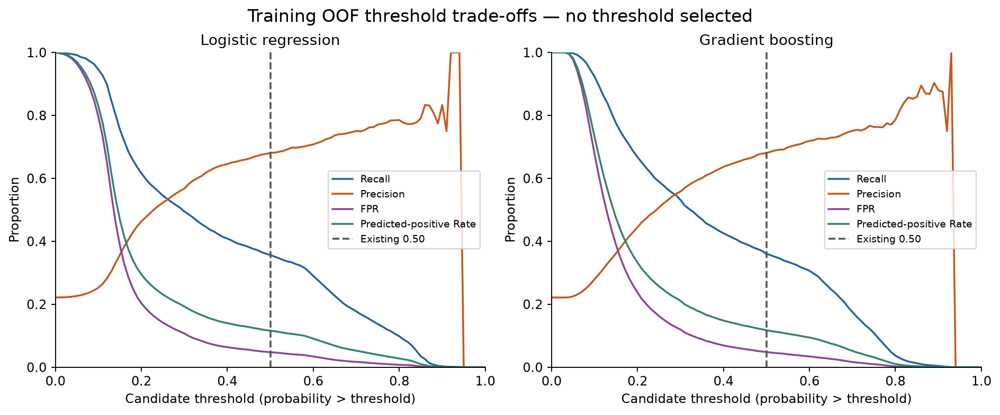
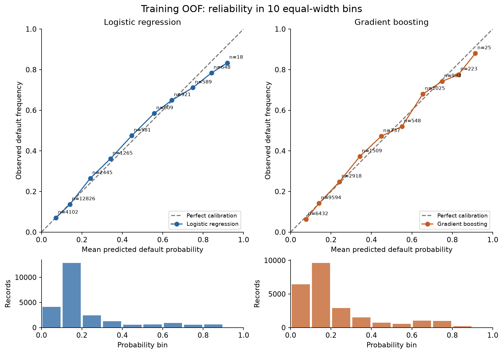

# Performance Evaluation

## Protocol and scope

The repaired partition is retained: **24,004 training records and 5,996 locked
holdout records**. Both original fitted preprocessing/model pipelines and their
prediction files remain unchanged, verified with SHA-256 hashes. All 22 existing
predictors and both model definitions are retained. ID and SEX are audit metadata.
The holdout was inspected during the earlier baseline stage; it is now locked
prospectively for development decisions and cannot become a historically unseen
test set retroactively.

Training-only `StratifiedGroupKFold(n_splits=5, shuffle=True, random_state=42)`
uses exact predictor groups, excluding ID, SEX and target. Each group appears in
one validation fold. Both algorithms share identical folds. Each fold fits a
fresh complete preprocessing/model pipeline on its four training folds, with
the existing hyperparameters. No model was tuned, calibrated, replaced, or saved
over the stabilized models. There is one OOF prediction per training ID per model.

## 1. Cross-validation consistency and stability

Gradient boosting has higher ROC-AUC in **5/5 folds** and higher AP in
**5/5 folds**. This is a descriptive within-fold
comparison, not a paired hypothesis test or significance claim.

| Fold | Logistic regression ROC-AUC | Gradient boosting ROC-AUC | Logistic regression Average Precision (AP) | Gradient boosting Average Precision (AP) |
| --- | --- | --- | --- | --- |
| 1 | 0.7740 | 0.7861 | 0.5383 | 0.5545 |
| 2 | 0.7697 | 0.7874 | 0.5488 | 0.5649 |
| 3 | 0.7658 | 0.7816 | 0.5452 | 0.5554 |
| 4 | 0.7669 | 0.7856 | 0.5494 | 0.5512 |
| 5 | 0.7691 | 0.7786 | 0.5445 | 0.5531 |

All fold-level metrics are in `tables/performance_evaluation/cv_fold_metrics.csv`.
The following are unweighted fold means and **sample SD (ddof=1)**. SD describes
variation across five fixed folds; it is not a standard error or confidence interval.

| Metric | Logistic regression mean ± SD | Gradient boosting mean ± SD |
| --- | --- | --- |
| ROC-AUC | 0.7691 ± 0.0031 | 0.7839 ± 0.0036 |
| Average Precision (AP) | 0.5452 ± 0.0044 | 0.5558 ± 0.0053 |
| Accuracy | 0.8205 ± 0.0029 | 0.8208 ± 0.0039 |
| Balanced Accuracy | 0.6545 ± 0.0051 | 0.6559 ± 0.0080 |
| Precision | 0.6809 ± 0.0132 | 0.6801 ± 0.0145 |
| Recall | 0.3567 ± 0.0102 | 0.3600 ± 0.0160 |
| Specificity | 0.9524 ± 0.0027 | 0.9518 ± 0.0027 |
| F1 | 0.4680 ± 0.0102 | 0.4707 ± 0.0159 |
| Log Loss | 0.4363 ± 0.0015 | 0.4273 ± 0.0017 |
| Brier Score | 0.1362 ± 0.0003 | 0.1339 ± 0.0007 |

Validation sizes range from 4,800 to
4,802, with default rates
22.1412%–22.1574%.
See `cv_partition_summary.csv` for group counts and zero group-overlap checks.
The SDs quantify metric stability on these folds only. Recall and precision can
vary even while the ranking advantage is consistent. Neither model is established
as superior across all performance dimensions: the fixed holdout favors different
models on different metrics, and no business objective or significance test was specified.

Pooled OOF metrics are also saved; nonlinear metrics of pooled predictions need
not equal the mean of fold metrics. OOF models train on roughly 80% of the training
partition, whereas the saved holdout models were fitted on all training records.

## 2. Training-only threshold trade-offs

The grid is 0.00 to 1.00 inclusive in steps of 0.01. Class 1 means probability
**strictly greater than** the threshold (ties are class 0), matching both baseline
estimators at 0.50. Precision and F1 are reported as zero when there are no positive
predictions. Every grid row reports positive rate, accuracy, balanced accuracy,
precision, recall, specificity, FPR, FNR and F1. These are pooled OOF diagnostics.

Selected grid rows, including the existing 0.50:

| model | threshold | Recall | Precision | Specificity | FPR | Predicted-positive Rate | F1 |
| --- | --- | --- | --- | --- | --- | --- | --- |
| gradient_boosting | 0.5000 | 0.3600 | 0.6802 | 0.9518 | 0.0482 | 0.1172 | 0.4708 |
| gradient_boosting | 0.4000 | 0.4255 | 0.6370 | 0.9310 | 0.0690 | 0.1479 | 0.5102 |
| gradient_boosting | 0.3000 | 0.5312 | 0.5581 | 0.8804 | 0.1196 | 0.2108 | 0.5443 |
| gradient_boosting | 0.2000 | 0.6674 | 0.4447 | 0.7629 | 0.2371 | 0.3324 | 0.5338 |
| logistic | 0.5000 | 0.3567 | 0.6808 | 0.9524 | 0.0476 | 0.1160 | 0.4681 |
| logistic | 0.4000 | 0.4086 | 0.6453 | 0.9361 | 0.0639 | 0.1402 | 0.5003 |
| logistic | 0.3000 | 0.4945 | 0.5677 | 0.8929 | 0.1071 | 0.1929 | 0.5286 |
| logistic | 0.2000 | 0.6164 | 0.4631 | 0.7967 | 0.2033 | 0.2948 | 0.5289 |

Lower thresholds increase recall, false positives and the fraction flagged for
default. Precision typically falls; its behavior is empirical rather than strictly
monotone. These tables quantify the workload and false-positive trade-off without
assuming that higher recall alone is preferable.

### Recall-target candidates — no threshold selected

For each target, sort scores of OOF positive cases and take the score of the
`ceil(target × number_of_positives)`th highest case. The candidate is the nearest
representable float below that score; this is the highest representable threshold
achieving at least the requested empirical recall. All tied scores are included,
so achieved recall can exceed the target. The table shows approximate thresholds;
use full-precision CSV values loaded with `float_precision="round_trip"` for
reproduction. Candidates are **not implemented**
and have no holdout performance estimates. Achieving an OOF target does not
guarantee that recall on future data.

| model | recall_target | threshold | Recall | Precision | Specificity | FPR | Predicted-positive Rate |
| --- | --- | --- | --- | --- | --- | --- | --- |
| Logistic regression | 0.4000 | 0.4137 | 0.4001 | 0.6511 | 0.9390 | 0.0610 | 0.1361 |
| Logistic regression | 0.5000 | 0.2950 | 0.5000 | 0.5634 | 0.8898 | 0.1102 | 0.1966 |
| Logistic regression | 0.6000 | 0.2087 | 0.6001 | 0.4746 | 0.8111 | 0.1889 | 0.2800 |
| Logistic regression | 0.7000 | 0.1652 | 0.7002 | 0.3942 | 0.6939 | 0.3061 | 0.3934 |
| Gradient boosting | 0.4000 | 0.4362 | 0.4001 | 0.6541 | 0.9398 | 0.0602 | 0.1355 |
| Gradient boosting | 0.5000 | 0.3228 | 0.5000 | 0.5821 | 0.8979 | 0.1021 | 0.1902 |
| Gradient boosting | 0.6000 | 0.2408 | 0.6001 | 0.4961 | 0.8266 | 0.1734 | 0.2679 |
| Gradient boosting | 0.7000 | 0.1842 | 0.7002 | 0.4219 | 0.7270 | 0.2730 | 0.3676 |

## 3. Probability calibration assessment

| model | partition | records | mean_probability | observed_frequency | Brier Score | Log Loss | ECE_10_uniform_bins |
| --- | --- | --- | --- | --- | --- | --- | --- |
| logistic | training_oof | 24004 | 0.2214 | 0.2215 | 0.1362 | 0.4363 | 0.0098 |
| gradient_boosting | training_oof | 24004 | 0.2214 | 0.2215 | 0.1339 | 0.4273 | 0.0101 |
| logistic | locked_holdout | 5996 | 0.2215 | 0.2201 | 0.1382 | 0.4409 | 0.0140 |
| gradient_boosting | locked_holdout | 5996 | 0.2220 | 0.2201 | 0.1350 | 0.4301 | 0.0107 |

Logistic regression OOF: mean probability 0.2214 versus default frequency 0.2215; ECE 0.0098. Among bins with at least 100 records, the largest absolute gap is 0.0576 in [0.8, 0.9), n=648 (predicted 0.8416, observed 0.7840). Gradient boosting OOF: mean probability 0.2214 versus default frequency 0.2215; ECE 0.0101. Among bins with at least 100 records, the largest absolute gap is 0.0547 in [0.8, 0.9), n=223 (predicted 0.8305, observed 0.7758).

At this ten-bin resolution, both OOF curves broadly track the diagonal, with
count-weighted absolute gaps around one percentage point. Neither has a substantial
overall mean offset. This is descriptive agreement, not a calibration guarantee.
Mean agreement alone does not imply calibration at each risk level. Reliability
curves show local deviations; sparse high-probability bins have noisy observed
frequencies. Use bin counts when interpreting them. There is no pre-specified ECE
pass/fail tolerance, so these findings do not justify declaring either model fully
calibrated or automatically choosing a correction.

Definitions: binary Brier score = mean `(probability - outcome)^2`; log loss uses
natural logs and sklearn's numerical clipping. ECE = sum over 10 equal-width bins
of `(bin_count / N) × abs(mean_probability - observed_frequency)`. Bins are
left-closed/right-open, with 1.0 included in the final bin. Empty bins remain in
the CSV with count zero and missing means; they contribute zero to ECE. ECE depends
on this binning choice. Brier and log loss evaluate overall probability quality,
including discrimination, rather than calibration alone.
[Source: sklearn calibration guide](https://scikit-learn.org/stable/modules/calibration.html).

The separate locked-holdout calibration plot is fixed-model evaluation only.
No Platt scaling, isotonic regression, or other calibrator was fitted. If correction
is later authorized, compare candidate calibration methods using training-only
validation/nested OOF predictions and decide using a pre-specified criterion.

## 4. Locked holdout at the existing 0.50

Confusion matrices use rows = actual [0, 1], columns = predicted [0, 1]:
`[[TN, FP], [FN, TP]]`.

| model | TN | FP | FN | TP |
| --- | --- | --- | --- | --- |
| logistic | 4437 | 239 | 852 | 468 |
| gradient_boosting | 4439 | 237 | 856 | 464 |

All fixed-threshold classification and probability/ranking scores, with 95% intervals:

| Metric | Logistic regression [95% CI] | Gradient boosting [95% CI] |
| --- | --- | --- |
| ROC-AUC | 0.7569 [0.7412, 0.7719] | 0.7781 [0.7628, 0.7923] |
| Average Precision (AP) | 0.5270 [0.4982, 0.5572] | 0.5521 [0.5226, 0.5814] |
| Accuracy | 0.8180 [0.8079, 0.8277] | 0.8177 [0.8079, 0.8270] |
| Balanced Accuracy | 0.6517 [0.6381, 0.6650] | 0.6504 [0.6367, 0.6637] |
| Precision | 0.6620 [0.6259, 0.6967] | 0.6619 [0.6257, 0.6971] |
| Recall | 0.3545 [0.3273, 0.3805] | 0.3515 [0.3250, 0.3777] |
| Specificity | 0.9489 [0.9424, 0.9551] | 0.9493 [0.9427, 0.9554] |
| F1 | 0.4618 [0.4333, 0.4884] | 0.4592 [0.4312, 0.4860] |
| Log Loss | 0.4409 [0.4264, 0.4561] | 0.4301 [0.4158, 0.4448] |
| Brier Score | 0.1382 [0.1325, 0.1440] | 0.1350 [0.1295, 0.1408] |

Baseline point estimates remain unchanged; specificity, probability losses and
intervals extend their evaluation. The current-facing label is **Average Precision
(AP)** for `average_precision_score`, not trapezoidal PR-AUC. The archived earlier
artifacts retain their original labels.
[Source: sklearn AP definition](https://scikit-learn.org/stable/modules/generated/sklearn.metrics.average_precision_score.html).

## 5. Confidence interval procedure

Use **2,000 bootstrap repetitions**, NumPy `default_rng(42)`.
From the 5,977 distinct holdout predictor groups, sample
that same number of groups with replacement. Every selected group contributes all
its records; repeated selection repeats the whole group. Implementation uses
integer row multiplicities as sample weights, equivalent to explicitly expanding
the sampled records. Sample record counts can vary because group sizes differ.
No bootstrap is stratified by label or SEX. Both models use the same resamples,
but no difference intervals, p-values, or paired model-comparison test are computed.

Intervals are the 2.5th and 97.5th percentiles (linear quantile interpolation) of
the bootstrap metric estimates. Samples missing an outcome class are skipped:
**0 skipped, 2000 valid**.
All replicates are saved for inspection. These intervals condition on the fitted
models and observed holdout groups; they do not include model-development,
retraining, or future population-shift uncertainty. Overlap/non-overlap of marginal
intervals is not used as a significance test.

## 6. Limitations and decisions before fairness analysis

- One repaired split and one five-fold assignment do not characterize all possible
  sampling variability. Fold training sets overlap, so fold scores are correlated.
- Keeping groups together handles exact predictor dependence; it does not establish
  independence of all other customers or address unobserved relationships.
- Threshold candidates are described on the same OOF data used to locate them.
  They need training-only confirmation/nested validation if later selected; no
  claims about holdout performance at candidate thresholds are made.
- Calibration bin deviations and ECE are descriptive and bin-dependent. There is
  no fitted calibrator, calibration-method selection, or threshold optimization.
- The locked holdout's earlier inspection must remain disclosed in any final paper.
- Retain both the transparent logistic baseline and the nonlinear boosting model.
  Fairness, SAFE, SHAP, robustness, mitigation, PSI/stability, intersectional and
  governance work remain outside this stage.

Before fairness analysis, decide whether 0.50 remains the comparison threshold or
whether a training-only threshold-selection protocol should be agreed. Define a
business objective (costs, acceptable false-positive burden, or recall constraint),
whether models should share a threshold or an operating criterion, and how to
validate any choice. Also decide whether calibration assessment alone is sufficient
or a separately authorized training-only calibration experiment is warranted.
None of these choices has been made automatically.

## Reproduction and outputs

Run `python script_performance_evaluation.py` with the existing pinned environment.
It reads the stabilized artifacts, fits temporary CV models, and regenerates this
stage's tables and figures. It never invokes preparation, a full-data split, or
baseline model persistence. Subsequent runs verify the locked-input hashes in
`tables/performance_evaluation/run_manifest.json`. The notebook
`../notebooks/05_performance_evaluation.ipynb` documents and displays the saved
results without retraining or accessing alternate holdout thresholds.

Created implementation: `src/performance_evaluation.py`, `src/performance_report.py`,
`script_performance_evaluation.py`, `tests/test_performance_evaluation.py`, and
`notebooks/05_performance_evaluation.ipynb`. Updated: README, current baseline AP
labels in both scripts/model notebooks/current metric CSVs, and the corresponding
stabilization test. Historical reports/archives and fitted baseline artifacts remain fixed.

All new CSVs live under `outputs/tables/performance_evaluation/`:
`cv_fold_metrics`, `cv_summary_metrics`, `cv_fold_assignments`, `cv_partition_summary`,
`oof_predictions`, `oof_metrics`, `threshold_tradeoffs`, `recall_target_candidates`,
`calibration_bins`, `calibration_summary`, `holdout_predictions`, `holdout_metrics`,
`holdout_confidence_intervals`, `holdout_bootstrap_replicates`, and
`overall_performance_comparison`. `run_manifest.json` records inputs, settings,
versions, source hashes and CSV hashes. Four figures are saved as PNG and SVG under
`outputs/figures/performance_evaluation/`: OOF/holdout calibration, OOF threshold
trade-offs, and OOF ROC/precision-recall curves. This report is
`outputs/performance_evaluation_report.md`.
