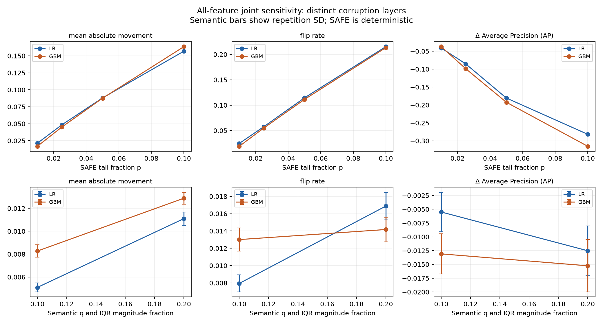
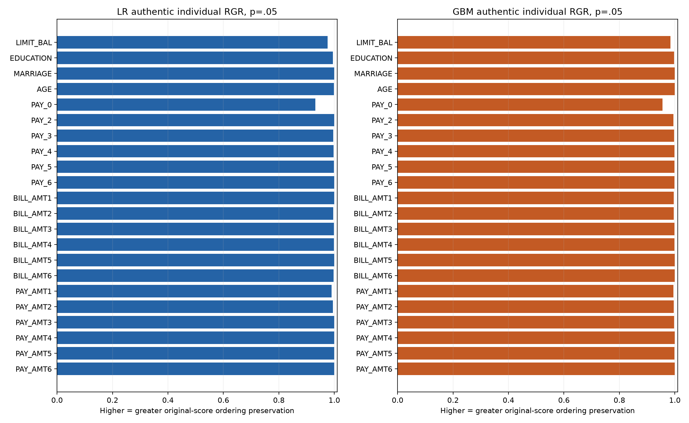
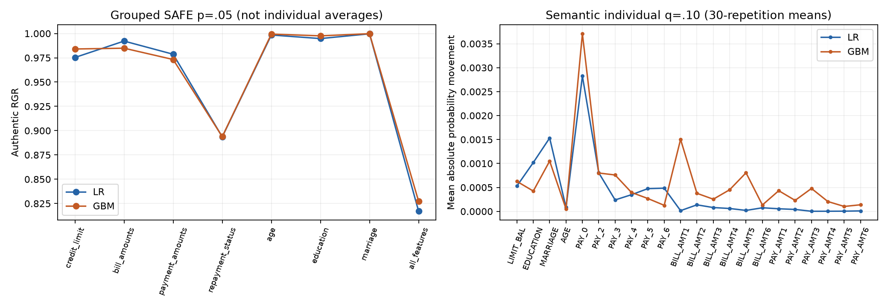

# Robustness evaluation — 8 October 2026

This completed empirical experiment measures prediction and recorded-outcome sensitivity of the existing frozen LR and GBM under prespecified synthetic input corruption. The two primary scenarios were fixed before results. It does not validate the entire extended trustworthiness framework or establish novelty.

## Frozen baseline and prespecified protocol

The repository baseline reproduced: 24,004 training and 5,996 holdout records, unchanged split and 22 predictors in the frozen input order. Default is class 1 and SAFE selects probability column 1 of classes [0,1]. Decisions are strictly p>0.50, including equality as class 0. IDs, SEX, outcomes and canonical order match all four earlier-stage prediction artifacts per model. Probability tolerance is 1e-15 absolute, metric tolerance 1e-12. No baseline conflict was found; no fitting, resplitting, feature changes, calibration or threshold selection occurred.

| model | ROC-AUC | Average Precision (AP) | Brier Score | Accuracy | Recall | TN | FP | FN | TP |
| --- | --- | --- | --- | --- | --- | --- | --- | --- | --- |
| logistic | 0.75695 | 0.52701 | 0.13817 | 0.81805 | 0.35455 | 4437.00000 | 239.00000 | 852.00000 | 468.00000 |
| gradient_boosting | 0.77813 | 0.55214 | 0.13498 | 0.81771 | 0.35152 | 4439.00000 | 237.00000 | 856.00000 | 464.00000 |

Trace: `baseline_reproduction.csv`, `baseline_metrics.csv`, `audit_predictions.csv`. The protocol, training-only scales/maps, all child seeds, bounds, rounding, metrics and uncertainty estimands were saved in `protocol.json` and `protocol_rationale.md` before robustness results. The latter records the rationale and every scope limitation.

The article-level motivation is comparison across trustworthiness dimensions. The package-defined SAFE operation is opposite-tail exchange on supplied evaluation inputs. Our semantic layer is supplementary domain-informed research design. The layers are not severity-equivalent, and neither is a measured error process.

## Authentic SAFE implementation and validation

Installed safeaipackage 0.8.3; robustness source SHA-256 `0bbb45f8de43a546732010e9f468c10d44c849a845f4cfb4397ae585a120c066`. Installed commit metadata is unavailable. Core and utilities retain earlier verified source identities; this robustness module is identified by its inspected installed-file hash, with no upstream commit equality claim. Unmodified source is recorded in `safe_source_inspection.txt`.

SAFE converts inputs with pandas.DataFrame and resets indices. perturb returns a reset-index frame and writes swapped values; independent deep copies isolate caller data. Python stable value sorting orders tails, then exchanges symmetric extreme pairs (upper tail reversed). For N=5,996 the nominal participation per feature is 118, 298, 598 and 1,198 at p=.01,.025,.05,.10 respectively, using min(ceil(pN), N−ceil((1−p)N)) pairs. Actual changes may be fewer for ties. Joint union counts are measured, not assumed to equal twice p.

The actual compute_rgr_values API is invoked for every individual and grouped SAFE scenario. The classifier adapter forwards exactly the frozen ordered predictors and fitted preprocessing. Its predictions equal the frozen baseline; fitting raises. Its captured internal transformed inputs must exactly equal the inputs used for conventional diagnostics. Both models share those inputs. Original API arrays, reset indices and restored canonical IDs are verified. Individual calls use one variable at a time to isolate each scenario; grouped calls jointly transform the declared ordered group.

core.rga computes rga(original default probabilities, perturbed default probabilities). It ranks the second vector with min ranks, replaces original scores tied on perturbed scores by their within-tie mean, sorts by perturbed scores and normalizes a weighted concordance sum between descending and ascending original magnitudes. Higher RGR means greater preservation; it is not simply rank-vector correlation. Model-specific normalization prevents treating an RGR difference as a common probability-error scale.

| fixture | value | expected | status | reason |
| --- | --- | --- | --- | --- |
| identity | 1.00000 | 1.00000 | defined |  |
| preserved_order | 1.00000 | 1.00000 | defined |  |
| reversed_order | 0.00000 | 0.00000 | defined |  |
| original_ties | 1.00000 | 1.00000 | defined |  |
| perturbed_ties | 0.90000 | 0.90000 | defined |  |
| both_ties | 1.00000 | 1.00000 | defined |  |
| constant_original | undefined | undefined | undefined | constant original scores: inc minus dec equals zero |
| constant_perturbed | 0.50000 | 0.50000 | defined |  |
| API_index_reset_constant_False_p_0.0 | 1.00000 | 1.00000 | defined |  |
| API_index_reset_constant_False_p_0.25 | 0.10000 | 0.10000 | defined |  |
| API_index_reset_constant_True_p_0.0 | undefined | undefined | undefined | constant original scores: zero normalization |
| API_index_reset_constant_True_p_0.25 | undefined | undefined | undefined | constant original scores: zero normalization |
| API_constant_perturbed | 0.50000 | 0.50000 | defined |  |

Constant original scores give undefined RGR because inc−dec=0; these are retained as fixture findings. Constant perturbed scores give 0.5 for nonconstant original scores. Fixtures cover identity, preserved/reversed ordering, original/perturbed ties, both constant cases, authentic API calls and noncanonical indices. Runtime API/direct-core agreement is checked at 1e-14. Weighted AUC/AP bootstrap calculations separately agree with sklearn and expanded samples within 2e-14 (`weighted_ranking_validation.csv`).

## Primary joint findings

`safe__group_all_features__p_0.05`: LR/GBM mean absolute movement 0.087993/0.087578; flips 11.441%/11.124%. AP changes are -0.180604/-0.192427; signed improvements and adverse changes are retained.

`semantic__all_features__primary`: LR/GBM mean absolute movement 0.005091/0.008270; flips 0.794%/1.301%. AP changes are -0.005498/-0.013093; signed improvements and adverse changes are retained.

| scenario | model | RGR |
| --- | --- | --- |
| safe__group_all_features__p_0.05 | logistic | 0.81702 |
| safe__group_all_features__p_0.05 | gradient_boosting | 0.82723 |

GBM minus LR primary SAFE RGR difference: +0.010215. This must be interpreted with the following probability movement, flips and performance, since high RGR does not guarantee accurate probabilities, fairness, safety or general reliability.

| scenario | model | Average Precision (AP) | Brier Score | ROC-AUC | Spearman | delta_Average Precision (AP) | delta_Brier Score | delta_ROC-AUC | flip_rate | mean_absolute_movement |
| --- | --- | --- | --- | --- | --- | --- | --- | --- | --- | --- |
| safe__group_all_features__p_0.05 | gradient_boosting | 0.35971 | 0.16618 | 0.68159 | 0.64758 | -0.19243 | 0.03120 | -0.09654 | 0.11124 | 0.08758 |
| safe__group_all_features__p_0.05 | logistic | 0.34641 | 0.17099 | 0.65871 | 0.60508 | -0.18060 | 0.03282 | -0.09824 | 0.11441 | 0.08799 |
| semantic__all_features__primary | gradient_boosting | 0.53904 | 0.13727 | 0.77270 | 0.98590 | -0.01309 | 0.00229 | -0.00544 | 0.01301 | 0.00827 |
| semantic__all_features__primary | logistic | 0.52151 | 0.13918 | 0.75472 | 0.99147 | -0.00550 | 0.00101 | -0.00223 | 0.00794 | 0.00509 |

Each headline row identifies its saved scenario. Trace: `authentic_rgr.csv`, `diagnostic_summary.csv`, `conventional_diagnostics.csv`. Metric changes are perturbed minus baseline; paired differences are GBM minus LR. Higher AUC/AP/classification scores mean better recorded-outcome performance; higher Brier/log loss/ECE mean greater error; higher absolute movement and flips mean greater instability. Signed movement has no inherent favorable direction. Repetition metrics are calculated before averaging; probabilities are never averaged for primary nonlinear metrics.

| scenario | metric | mean | mc_sd |
| --- | --- | --- | --- |
| safe__group_all_features__p_0.05 | eligible | 5996.00000 | undefined |
| safe__group_all_features__p_0.05 | selected | 3906.00000 | undefined |
| safe__group_all_features__p_0.05 | eligible_selected | 3906.00000 | undefined |
| safe__group_all_features__p_0.05 | changed | 3906.00000 | undefined |
| safe__group_all_features__p_0.05 | changed_cells | 13156.00000 | undefined |
| safe__group_all_features__p_0.05 | clipped | 0.00000 | undefined |
| safe__group_all_features__p_0.05 | no_op | 0.00000 | undefined |
| safe__group_all_features__p_0.05 | outside_support | 0.00000 | undefined |
| safe__group_all_features__p_0.05 | selected_outside_support | 0.00000 | undefined |
| safe__group_all_features__p_0.05 | special_state_selected | 0.00000 | undefined |
| safe__group_all_features__p_0.05 | changed_rate | 0.65143 | undefined |
| semantic__all_features__primary | eligible | 5996.00000 | 0.00000 |
| semantic__all_features__primary | selected | 599.00000 | 0.00000 |
| semantic__all_features__primary | eligible_selected | 599.00000 | 0.00000 |
| semantic__all_features__primary | changed | 599.00000 | 0.00000 |
| semantic__all_features__primary | changed_cells | 9628.63333 | 29.78021 |
| semantic__all_features__primary | clipped | 471.46667 | 27.76718 |
| semantic__all_features__primary | no_op | 0.00000 | 0.00000 |
| semantic__all_features__primary | outside_support | 1.00000 | 0.00000 |
| semantic__all_features__primary | selected_outside_support | 0.06667 | 0.25371 |
| semantic__all_features__primary | special_state_selected | 3102.13333 | 32.29149 |
| semantic__all_features__primary | changed_rate | 0.09990 | 0.00000 |

Exposure depends on changed inputs, never on whether a model prediction moved. The union row counts changed clients and changed cells separately. In union rows, clipping/outside-support/special-state counts sum feature cells; feature rows contain record counts. `exposure_counts.csv` contains selected, eligible, eligible-selected, changed, clipped, no-op, outside-support and special-state counts by feature/SEX/repetition; `exposure_summary.csv` reports repetition means and spread.

## Paired sampling uncertainty and Monte Carlo variation

| scenario | model | metric | estimate | ci_lower | ci_upper |
| --- | --- | --- | --- | --- | --- |
| safe__group_all_features__p_0.05 | logistic | mean_absolute_movement | 0.08799 | 0.08379 | 0.09215 |
| safe__group_all_features__p_0.05 | logistic | flip_rate | 0.11441 | 0.10640 | 0.12269 |
| safe__group_all_features__p_0.05 | logistic | delta_ROC-AUC | -0.09824 | -0.11390 | -0.08250 |
| safe__group_all_features__p_0.05 | logistic | delta_Average Precision (AP) | -0.18060 | -0.20510 | -0.15552 |
| safe__group_all_features__p_0.05 | logistic | delta_Brier Score | 0.03282 | 0.02830 | 0.03726 |
| safe__group_all_features__p_0.05 | gradient_boosting | mean_absolute_movement | 0.08758 | 0.08357 | 0.09151 |
| safe__group_all_features__p_0.05 | gradient_boosting | flip_rate | 0.11124 | 0.10320 | 0.11952 |
| safe__group_all_features__p_0.05 | gradient_boosting | delta_ROC-AUC | -0.09654 | -0.11018 | -0.08288 |
| safe__group_all_features__p_0.05 | gradient_boosting | delta_Average Precision (AP) | -0.19243 | -0.21613 | -0.16737 |
| safe__group_all_features__p_0.05 | gradient_boosting | delta_Brier Score | 0.03120 | 0.02715 | 0.03528 |
| safe__group_all_features__p_0.05 | GBM_minus_LR | mean_absolute_movement | -0.00042 | -0.00225 | 0.00141 |
| safe__group_all_features__p_0.05 | GBM_minus_LR | flip_rate | -0.00317 | -0.00850 | 0.00217 |
| safe__group_all_features__p_0.05 | GBM_minus_LR | delta_ROC-AUC | 0.00169 | -0.00880 | 0.01187 |
| safe__group_all_features__p_0.05 | GBM_minus_LR | delta_Average Precision (AP) | -0.01182 | -0.02319 | -0.00029 |
| safe__group_all_features__p_0.05 | GBM_minus_LR | delta_Brier Score | -0.00163 | -0.00356 | 0.00032 |
| semantic__all_features__primary | logistic | mean_absolute_movement | 0.00509 | 0.00488 | 0.00531 |
| semantic__all_features__primary | logistic | flip_rate | 0.00794 | 0.00736 | 0.00854 |
| semantic__all_features__primary | logistic | delta_ROC-AUC | -0.00223 | -0.00277 | -0.00165 |
| semantic__all_features__primary | logistic | delta_Average Precision (AP) | -0.00550 | -0.00735 | -0.00381 |
| semantic__all_features__primary | logistic | delta_Brier Score | 0.00101 | 0.00080 | 0.00123 |
| semantic__all_features__primary | gradient_boosting | mean_absolute_movement | 0.00827 | 0.00792 | 0.00865 |
| semantic__all_features__primary | gradient_boosting | flip_rate | 0.01301 | 0.01217 | 0.01392 |
| semantic__all_features__primary | gradient_boosting | delta_ROC-AUC | -0.00544 | -0.00629 | -0.00454 |
| semantic__all_features__primary | gradient_boosting | delta_Average Precision (AP) | -0.01309 | -0.01535 | -0.01069 |
| semantic__all_features__primary | gradient_boosting | delta_Brier Score | 0.00229 | 0.00189 | 0.00269 |
| semantic__all_features__primary | GBM_minus_LR | mean_absolute_movement | 0.00318 | 0.00297 | 0.00340 |
| semantic__all_features__primary | GBM_minus_LR | flip_rate | 0.00507 | 0.00450 | 0.00565 |
| semantic__all_features__primary | GBM_minus_LR | delta_ROC-AUC | -0.00321 | -0.00401 | -0.00237 |
| semantic__all_features__primary | GBM_minus_LR | delta_Average Precision (AP) | -0.00759 | -0.00917 | -0.00578 |
| semantic__all_features__primary | GBM_minus_LR | delta_Brier Score | 0.00127 | 0.00101 | 0.00153 |

Trace: `sampling_intervals.csv` and `bootstrap_replicates.csv` also contain male and female intervals and within-resample subgroup counts. All intervals use 2,000 complete original predictor-group draws, seed 42, and 95% percentile bounds; both models and scenarios share draws. Cross-SEX/outcome groups are kept intact, so subgroup composition varies. Matching predictor inputs do not prove the same person. These are conditional intervals for frozen models and the observed SAFE tail swap or 30 saved semantic realizations. They do not estimate a repeated new-sample SAFE procedure. Repetition-wise nonlinear metrics and paired differences are recomputed within each resample and then averaged. No RGR interval or significance-testing grid is reported.

| model | metric | mean | mc_sd | minimum | maximum | repetitions |
| --- | --- | --- | --- | --- | --- | --- |
| logistic | mean_absolute_movement | 0.00509 | 0.00040 | 0.00446 | 0.00591 | 30 |
| logistic | Spearman | 0.99147 | 0.00102 | 0.98933 | 0.99325 | 30 |
| logistic | flip_rate | 0.00794 | 0.00098 | 0.00567 | 0.00967 | 30 |
| logistic | ROC-AUC | 0.75472 | 0.00113 | 0.75094 | 0.75687 | 30 |
| logistic | Average Precision (AP) | 0.52151 | 0.00358 | 0.51266 | 0.52845 | 30 |
| logistic | Brier Score | 0.13918 | 0.00044 | 0.13821 | 0.14036 | 30 |
| logistic | delta_ROC-AUC | -0.00223 | 0.00113 | -0.00601 | -0.00008 | 30 |
| logistic | delta_Average Precision (AP) | -0.00550 | 0.00358 | -0.01435 | 0.00144 | 30 |
| logistic | delta_Brier Score | 0.00101 | 0.00044 | 0.00004 | 0.00219 | 30 |
| gradient_boosting | mean_absolute_movement | 0.00827 | 0.00054 | 0.00725 | 0.00919 | 30 |
| gradient_boosting | Spearman | 0.98590 | 0.00145 | 0.98288 | 0.98947 | 30 |
| gradient_boosting | flip_rate | 0.01301 | 0.00134 | 0.01034 | 0.01518 | 30 |
| gradient_boosting | ROC-AUC | 0.77270 | 0.00175 | 0.76714 | 0.77532 | 30 |
| gradient_boosting | Average Precision (AP) | 0.53904 | 0.00365 | 0.52887 | 0.54587 | 30 |
| gradient_boosting | Brier Score | 0.13727 | 0.00056 | 0.13637 | 0.13877 | 30 |
| gradient_boosting | delta_ROC-AUC | -0.00544 | 0.00175 | -0.01099 | -0.00281 | 30 |
| gradient_boosting | delta_Average Precision (AP) | -0.01309 | 0.00365 | -0.02327 | -0.00627 | 30 |
| gradient_boosting | delta_Brier Score | 0.00229 | 0.00056 | 0.00139 | 0.00379 | 30 |

The semantic table gives between-repetition sample SD and range across 30 coupled realizations, separately from the sampling intervals. Deterministic SAFE has no Monte Carlo SD. Stronger semantic stress increases both selected fraction and magnitude; it is combined stress. Improvements and nonmonotonic changes are retained; monotonic deterioration is not assumed.

## Descriptive SEX-group findings

| model | SEX | group | records | default_rate | mean_probability | fraction_within_0.05_of_threshold | ROC-AUC | Average Precision (AP) |
| --- | --- | --- | --- | --- | --- | --- | --- | --- |
| logistic | 0 | all | 5996 | 0.22015 | 0.22154 | 0.02018 | 0.75695 | 0.52701 |
| logistic | 1 | male | 2404 | 0.23170 | 0.22597 | 0.02205 | 0.76131 | 0.52857 |
| logistic | 2 | female | 3592 | 0.21242 | 0.21856 | 0.01893 | 0.75339 | 0.52852 |
| gradient_boosting | 0 | all | 5996 | 0.22015 | 0.22201 | 0.02718 | 0.77813 | 0.55214 |
| gradient_boosting | 1 | male | 2404 | 0.23170 | 0.22809 | 0.03203 | 0.77407 | 0.54139 |
| gradient_boosting | 2 | female | 3592 | 0.21242 | 0.21794 | 0.02394 | 0.78053 | 0.56311 |

| scenario | model | SEX | selected | changed | exposure | mean_abs_movement | flip_rate | delta_AP | delta_AUC | delta_Brier |
| --- | --- | --- | --- | --- | --- | --- | --- | --- | --- | --- |
| safe__group_all_features__p_0.05 | logistic | 1 | 1601.00000 | 1601.00000 | 0.66597 | 0.08795 | 0.10982 | -0.15165 | -0.09499 | 0.02912 |
| safe__group_all_features__p_0.05 | gradient_boosting | 1 | 1601.00000 | 1601.00000 | 0.66597 | 0.08958 | 0.10691 | -0.16331 | -0.09755 | 0.02905 |
| safe__group_all_features__p_0.05 | logistic | 2 | 2305.00000 | 2305.00000 | 0.64170 | 0.08802 | 0.11748 | -0.19770 | -0.09897 | 0.03530 |
| safe__group_all_features__p_0.05 | gradient_boosting | 2 | 2305.00000 | 2305.00000 | 0.64170 | 0.08624 | 0.11414 | -0.21422 | -0.09535 | 0.03264 |
| semantic__all_features__primary | logistic | 1 | 237.26667 | 237.26667 | 0.09870 | 0.00505 | 0.00797 | -0.00440 | -0.00209 | 0.00091 |
| semantic__all_features__primary | gradient_boosting | 1 | 237.26667 | 237.26667 | 0.09870 | 0.00828 | 0.01316 | -0.01082 | -0.00515 | 0.00209 |
| semantic__all_features__primary | logistic | 2 | 361.73333 | 361.73333 | 0.10071 | 0.00512 | 0.00792 | -0.00632 | -0.00232 | 0.00109 |
| semantic__all_features__primary | gradient_boosting | 2 | 361.73333 | 361.73333 | 0.10071 | 0.00826 | 0.01291 | -0.01485 | -0.00567 | 0.00242 |

Trace: `baseline_by_sex.csv`, `baseline_features_by_sex.csv`, `diagnostic_summary.csv`, `exposure_summary.csv`, and subgroup sampling intervals. SEX=1 male / SEX=2 female is unchanged metadata. All summaries subset globally perturbed inputs; SAFE tails are never recalculated within SEX groups. The tables distinguish unequal exposure, model response, baseline feature/score distributions and baseline proximity within .05 of the classification threshold. Their descriptive associations do not establish discrimination, causality, or replace completed fairness results.

## Secondary order diagnostic and sensitivity analyses

The prespecified all-feature SAFE p=.05 permutation uses seed 20261008, aligned scores/metadata and the same input order for both models, with canonical ID order restored for comparisons. 1225 records differ in union exposure membership after permutation. Canonical order remains primary.

| model | SEX | metric | canonical | permuted | permuted_minus_canonical |
| --- | --- | --- | --- | --- | --- |
| logistic | 0 | input_exposure_rate | 0.65143 | 0.64860 | -0.00284 |
| logistic | 0 | mean_absolute_movement | 0.08799 | 0.08799 | -0.00000 |
| logistic | 0 | flip_rate | 0.11441 | 0.11558 | 0.00117 |
| logistic | 0 | delta_ROC-AUC | -0.09824 | -0.10429 | -0.00605 |
| logistic | 0 | delta_Average Precision (AP) | -0.18060 | -0.18437 | -0.00377 |
| logistic | 0 | delta_Brier Score | 0.03282 | 0.03417 | 0.00134 |
| logistic | 1 | input_exposure_rate | 0.66597 | 0.66764 | 0.00166 |
| logistic | 1 | mean_absolute_movement | 0.08795 | 0.08684 | -0.00111 |
| logistic | 1 | flip_rate | 0.10982 | 0.10857 | -0.00125 |
| logistic | 1 | delta_ROC-AUC | -0.09499 | -0.10479 | -0.00980 |
| logistic | 1 | delta_Average Precision (AP) | -0.15165 | -0.15649 | -0.00484 |
| logistic | 1 | delta_Brier Score | 0.02912 | 0.03058 | 0.00146 |
| logistic | 2 | input_exposure_rate | 0.64170 | 0.63586 | -0.00585 |
| logistic | 2 | mean_absolute_movement | 0.08802 | 0.08876 | 0.00074 |
| logistic | 2 | flip_rate | 0.11748 | 0.12027 | 0.00278 |
| logistic | 2 | delta_ROC-AUC | -0.09897 | -0.10259 | -0.00362 |
| logistic | 2 | delta_Average Precision (AP) | -0.19770 | -0.20191 | -0.00422 |
| logistic | 2 | delta_Brier Score | 0.03530 | 0.03657 | 0.00127 |
| logistic | 0 | RGR | 0.81702 | 0.82181 | 0.00479 |
| gradient_boosting | 0 | input_exposure_rate | 0.65143 | 0.64860 | -0.00284 |
| gradient_boosting | 0 | mean_absolute_movement | 0.08758 | 0.08660 | -0.00097 |
| gradient_boosting | 0 | flip_rate | 0.11124 | 0.11224 | 0.00100 |
| gradient_boosting | 0 | delta_ROC-AUC | -0.09654 | -0.10105 | -0.00450 |
| gradient_boosting | 0 | delta_Average Precision (AP) | -0.19243 | -0.19626 | -0.00384 |
| gradient_boosting | 0 | delta_Brier Score | 0.03120 | 0.03206 | 0.00086 |
| gradient_boosting | 1 | input_exposure_rate | 0.66597 | 0.66764 | 0.00166 |
| gradient_boosting | 1 | mean_absolute_movement | 0.08958 | 0.08764 | -0.00194 |
| gradient_boosting | 1 | flip_rate | 0.10691 | 0.10441 | -0.00250 |
| gradient_boosting | 1 | delta_ROC-AUC | -0.09755 | -0.10625 | -0.00870 |
| gradient_boosting | 1 | delta_Average Precision (AP) | -0.16331 | -0.16462 | -0.00131 |
| gradient_boosting | 1 | delta_Brier Score | 0.02905 | 0.02965 | 0.00061 |
| gradient_boosting | 2 | input_exposure_rate | 0.64170 | 0.63586 | -0.00585 |
| gradient_boosting | 2 | mean_absolute_movement | 0.08624 | 0.08591 | -0.00033 |
| gradient_boosting | 2 | flip_rate | 0.11414 | 0.11748 | 0.00334 |
| gradient_boosting | 2 | delta_ROC-AUC | -0.09535 | -0.09657 | -0.00122 |
| gradient_boosting | 2 | delta_Average Precision (AP) | -0.21422 | -0.21757 | -0.00334 |
| gradient_boosting | 2 | delta_Brier Score | 0.03264 | 0.03367 | 0.00103 |
| gradient_boosting | 0 | RGR | 0.82723 | 0.83323 | 0.00600 |

Trace: `row_order_diagnostic.csv`, `permutation_record_comparison.csv`, `realization_registry.csv`. Stable tie selection can affect tail membership and model response. Neither ordering is selected for a favorable comparison.

All 22 individual features and all eight SAFE groups run at each of the four severities. Grouped RGR is not an average of feature RGR. The semantic experiment covers every individual feature and the common-mask joint scenario at both levels and all 30 repetitions. All sensitivities, including null, adverse and unexpected results, remain in the saved tables. SAFE numeric category ordering is arbitrary; swaps preserve marginals but can break feature relationships and complete-record plausibility.

## Semantic assumptions, exposure coverage and undefined quantities

Observed training supports include {'PAY_0': [-2, -1, 0, 1, 2, 3, 4, 5, 6, 7, 8], 'PAY_5': [-2, -1, 0, 2, 3, 4, 5, 6, 7, 8], 'PAY_6': [-2, -1, 0, 2, 3, 4, 5, 6, 7, 8], 'EDUCATION': [1, 2, 3, 4], 'MARRIAGE': [1, 2, 3]}. Positive ordinary repayment states receive exact ±1/±2 destinations only when training-supported; missing destination/endpoints are no-ops. Special -2,-1,0 states remain unchanged, limiting coverage of repayment-status errors. No special-state experiment was added. All per-feature destination maps are in the saved protocol.

Monetary scales and category frequencies use only locked training records. Monetary changes are signed fixed IQR offsets, with integer NT-dollar rounding inferred from observed training precision. Nonnegative payments are bounded at zero, credit limits at the labelled training-support minimum; bills can be negative and monetary maxima are not capped. Age uses labelled training-support bounds. Selected baseline values outside a support bound stay unchanged. No-op reasons include special states, unsupported exact destinations, outside-support baselines, zero scale, rounding and clipping. Complete-holdout selection stays fixed regardless of eligibility.

All-record/changed-record undefined diagnostic entries: 0; undefined bootstrap metric replicates: 0. Undefined fixture values: 3. Individual reasons and counts are in `undefined_results.csv`, `safe_fixture_validation.csv`, `changed_record_movement.csv` and `sampling_intervals.csv`. Empty calibration bins intentionally have missing means and contribute zero ECE; `calibration_bins.csv` retains their zero counts. Repository precision/F1 conventions report zero with no positive denominator.

## Reproduction, provenance and limits

Run `.venv/Scripts/python.exe script_robustness_evaluation.py --verify`. Two full evaluations include every realization and all bootstrap draws; numerical CSVs and the prediction cache are compared byte-for-byte. The complete existing and new test suite and pip check run afterwards. `verification.json`, `test_results.txt`, `dependency_check.txt` record results. Run timestamps may differ; all other manifest metadata must agree exactly. `run_manifest.json` identifies protected artifacts, source/package versions, protocol and result hashes. Earlier data/models/splits/reports/outputs/code/dependency locks remain protected. README receives only an additive stage note.

Artifacts: 167 scenario IDs and 1501 saved realizations; compact `prediction_cache.npz` stores the shared baseline plus raw probabilities at saved record positions, input-change masks and storage masks in canonical ID order, keyed by `realization_registry.csv`. `src.robustness_cache.restore_probabilities` restores the exact original floating-point probabilities; storage masks also retain any numerical movement at unchanged inputs. The initial prespecified protocol is preserved in `initial_prespecified_protocol.json`; `implementation_revision.json` documents this storage-only revision with every analytical setting unchanged. Protocol parameters and child seeds reproduce perturbed inputs without full dataset copies. Primary bootstrap uses these cached original/perturbed pairs and never calls model prediction.

These synthetic experiments do not establish real-world error rates, causal default-risk changes, adversarial security, future-population reliability, a universally best model, or framework novelty. Recorded outcomes remain fixed; they are not counterfactual outcomes for behavior changes. High ordering preservation can coexist with probability movement and classification errors. The historically inspected Taiwanese holdout and binary source SEX metadata constrain wider conclusions. The stronger and SAFE/semantic stresses are not severity-equivalent. No later stability, PSI, monitoring, mitigation or governance stage was implemented.
