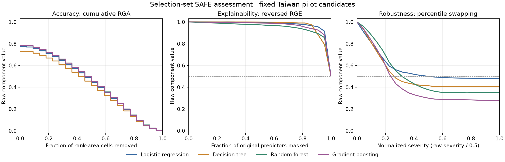

# Selection-set integrated SAFE assessment — 26 October 2026

Taiwan application of Giudici & Kolesnikov (2026), DOI 10.1016/j.mlwa.2025.100821. Four frozen, untuned primary candidates; 4,801 selection records. Fitting records supply references only.

## Scores and rankings

Higher is preferred. Arithmetic percentile swapping is the declared primary selector. Geometric and quadratic are cellwise sensitivity variants, not means of three curve averages.

| Candidate | Arithmetic | Rank | Geometric | Rank | Quadratic | Rank |
| --- | ---: | ---: | ---: | ---: | ---: | ---: |
| logistic | 0.65198723 | 1 | 0.54795043 | 1 | 0.71231360 | 1 |
| decision_tree | 0.62075994 | 3 | 0.51198962 | 3 | 0.68908734 | 3 |
| random_forest | 0.62308645 | 2 | 0.51785114 | 2 | 0.68959736 | 2 |
| gradient_boosting | 0.60389575 | 4 | 0.49027101 | 4 | 0.68146402 | 4 |

Primary selected candidate ID: **logistic**; status: selected; tied top IDs: ['logistic'].

## Component areas and sampled means

AURGA is the raw step area; reversed AURGE and swapping AURGR use trapezoidal areas. These areas are not the uniformly sampled node means entering Eqs. (13)-(17).

| Candidate | Scalar RGA | AURGA | Reversed AURGE | Swap AURGR | Mean A | Mean E | Mean R |
| --- | ---: | ---: | ---: | ---: | ---: | ---: | ---: |
| logistic | 0.77397487 | 0.43344800 | 0.97667363 | 0.56733601 | 0.41428768 | 0.96681825 | 0.57485575 |
| decision_tree | 0.73169973 | 0.40675797 | 0.97101716 | 0.50341524 | 0.38877313 | 0.96140772 | 0.51209896 |
| random_forest | 0.78437428 | 0.44058433 | 0.95177699 | 0.49739672 | 0.42111061 | 0.94300407 | 0.50514465 |
| gradient_boosting | 0.78607430 | 0.44071895 | 0.96766433 | 0.42284233 | 0.42123787 | 0.95820066 | 0.43224872 |

## Specification and fidelity

1. **Paper-prescribed:** Lorenz/concordance ratios (Eqs. 4, 8, 10, 12), cumulative RGA accounting (Eqs. 5-7), raw swapping severity 0-.5 normalized to 0-1, reversed RGE, and the three cellwise means uniformly averaged over the Cartesian grid (Eqs. 13-17). No fairness addition or cross-candidate normalization.
2. **User-approved Taiwan operational choices:** full-sample additive area slices; expected concordance within score ties; whole-original-predictor fixed-model masking at fitting-only numeric means/category modes; greedy maximum preservation against the full model; deterministic mirror tail pairing with ID tie breaks; all 22 original predictors swapped; 23 endpoint-inclusive grid nodes; explicit quadrature and tie rules. See protocol.json and the preserved specification/fidelity table. These are declared adaptations, not proof of the authors' exact HMDA implementation.
3. **Unresolved/unsupported reproduction:** Gaussian is deferred by explicit user decision because categorical treatment is unresolved. TOPSIS is unsupported because the exact matrix, normalization, directions, weights and ideal points are not identified. Later safe-ai-metrics 0.2.0 was inspected and hash pinned without installation; its different scalar divergence, local-slice rescaling, masking baselines, optional normalizations and nonfinite replacements were not silently adopted. source_inspection.json contains numerical counterexamples and provenance.

## Verification and diagnostics

18 synthetic tests passed before credit scoring; the unchanged 15 pilot tests also passed. Independent rank-weighted calculations reconstructed all 184 saved RGR/RGE values; explicit Cartesian products reconstructed all 12 integrated scores. Binary scalar RGA agrees with sklearn AUROC. All 1,012 greedy alternatives, nested paths, exact tie choices, selection IDs, class-1 mappings and finite probability bounds checked. Necessary chosen-path/perturbation predictions are saved compactly; alternative prediction hashes and scalar scores support deterministic regeneration.

- logistic: no/all-removal preservation 1/0.5; reversed-RGE increases at steps [5, 8]; RGR increases at intervals [19].
- decision_tree: no/all-removal preservation 1/0.5; reversed-RGE increases at steps []; RGR increases at intervals [16, 19].
- random_forest: no/all-removal preservation 1/0.5; reversed-RGE increases at steps []; RGR increases at intervals [15, 17, 18, 19, 21].
- gradient_boosting: no/all-removal preservation 1/0.5; reversed-RGE increases at steps []; RGR increases at intervals [].

All actual increases are retained. Undefined values are never replaced with zero, records are never dropped, and curves are not forced monotone. Swapping exposures and novel categorical combinations are reported separately in perturbation_diagnostics.json; preserved marginal categories do not imply semantically valid cross-feature combinations. No unsupported business constraints are invented. There is no stochastic repetition: no Monte Carlo or sampling interval is claimed.

All 544 pre-task protected files (including uncommitted pilot work and the entire candidate run) retain their hashes. All 410 historical manifest references passed before/after. Candidate completion and its recorded input/implementation identities passed before/after loading and assessment. No primary candidate or preprocessing object was fitted, modified or replaced; no auxiliary fitting occurred. No holdout predictions, performance or model-selection access. Only a hash-valid VERIFIED.json establishes completion.

## Limits and next decision

These are selection-set SAFE assessments conditional on this fixed candidate pool. They establish neither independent predictive superiority, human explanation quality, legal compliance, real-world robustness, nor a winner against our future methodology. The constructed grid is not a sampling distribution or measured simultaneous real-world faults. No threshold tuning, extended methodology or independent judge was implemented.

Next decision: specify the independent judge and practical comparison margins, including whether proposed Brier is primary, LogLoss secondary/co-primary, and how any independent explainability requirement is defined. Prior holdout inspection still makes Taiwan exploratory.
